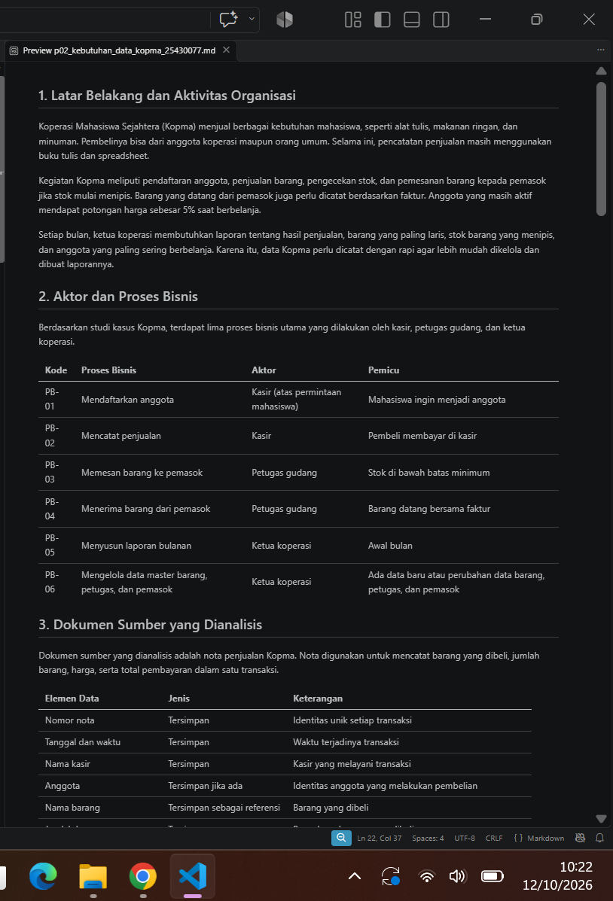
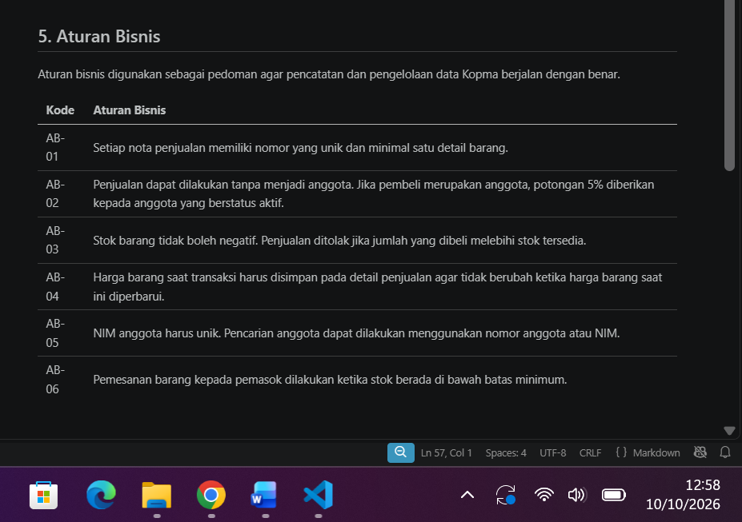
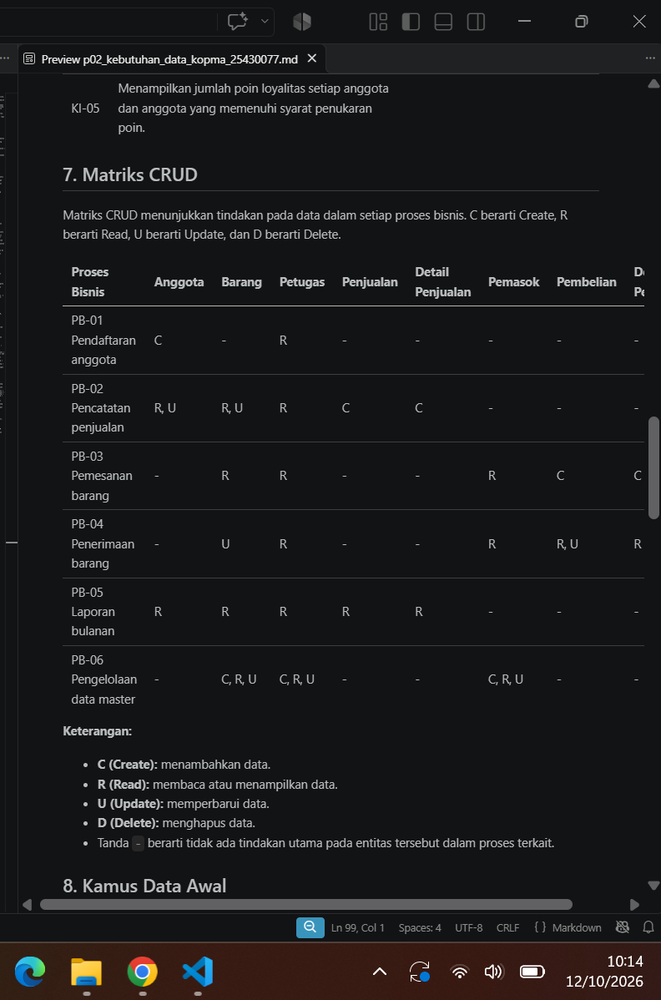
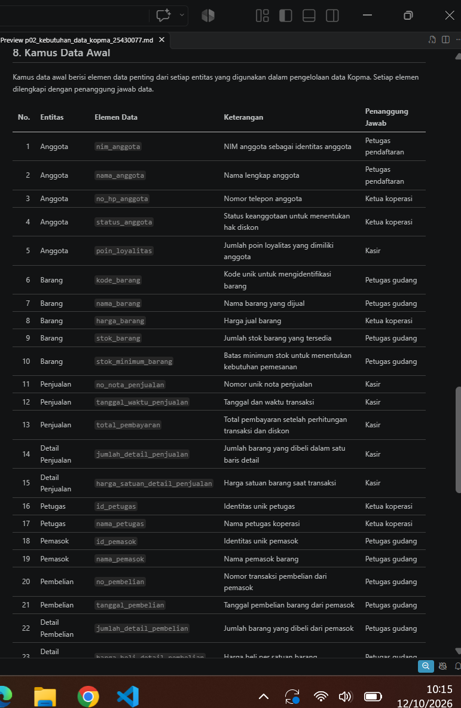
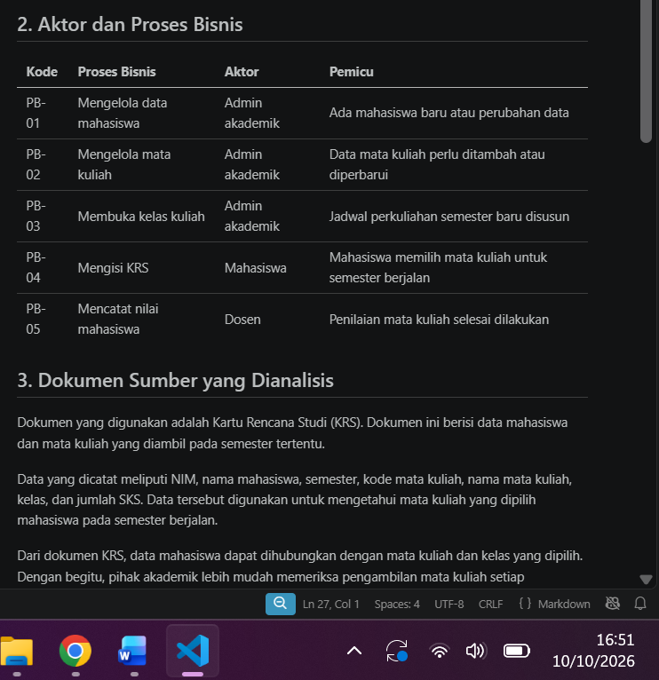
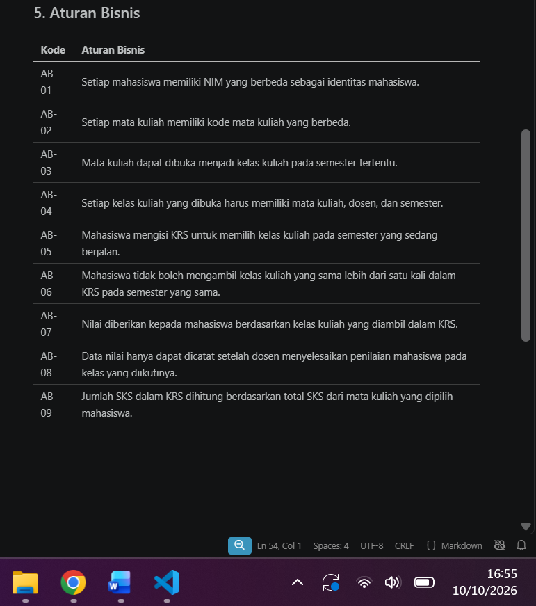
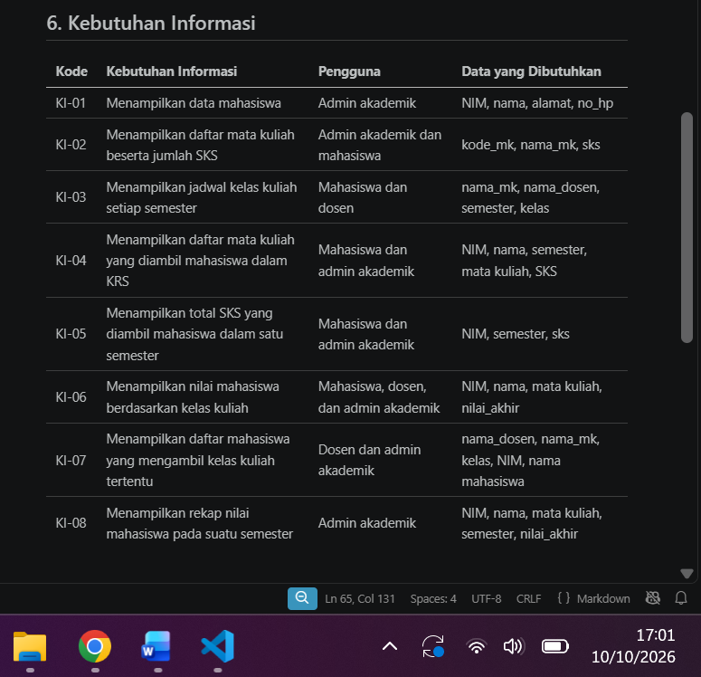
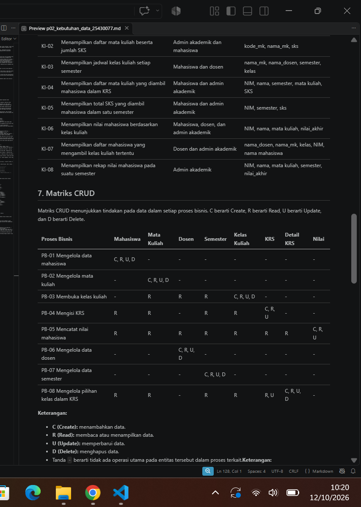
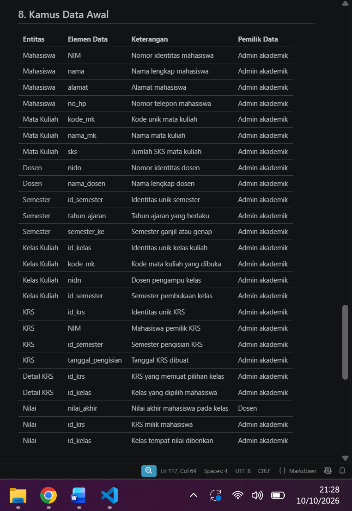
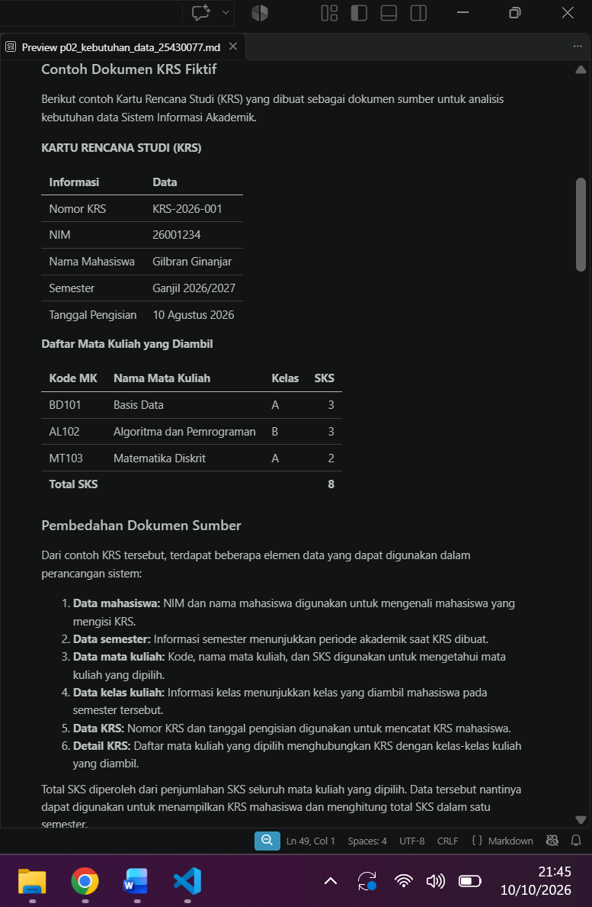

## Laporan Praktikum Basis Data - Pertemuan 2
**Nama** : Divva Ramadhan Puja Pratama

**NPM** : 25430077

**Kelas** : C

**Tanggal** : 10 Oktober 2026

**Dosen Pengampu** : Dedi Irawan, S.Kom., M.Kom.
## 1. Tujuan Praktikum

Praktikum ini bertujuan untuk memahami cara menentukan kebutuhan data berdasarkan kegiatan suatu organisasi. Selain itu, praktikum ini juga membantu dalam mengenali proses bisnis, data yang dibutuhkan, serta aturan yang harus diterapkan. Hasil analisis tersebut nantinya digunakan sebagai dasar dalam merancang basis data untuk proyek Sistem Informasi Akademik.

## 2. Ringkasan Dasar Teori

Analisis kebutuhan data dilakukan untuk mengetahui data apa saja yang dibutuhkan dalam suatu organisasi. Caranya dengan melihat kegiatan yang dilakukan, siapa saja yang terlibat, dan informasi apa yang diperlukan.

Hasil analisis ini digunakan untuk menyusun aturan bisnis, matriks CRUD, dan kamus data. Dokumen tersebut nantinya menjadi dasar untuk merancang basis data.

## 3. Hasil Langkah Percobaan

Pada praktikum ini, saya mengerjakan analisis kebutuhan data berdasarkan studi kasus Kopma. Kegiatan yang dilakukan meliputi identifikasi proses bisnis, penentuan entitas dan aturan bisnis, penyusunan kebutuhan informasi, serta pembuatan matriks CRUDS dan kamus data awal.

### 3.1 Tabel Aktor dan Proses Bisnis 
Tabel ini berisi daftar proses bisnis yang dilakukan di Kopma, pihak yang terlibat, serta pemicu dari setiap proses.

### 3.2 Tabel Aturan Bisnis 
Tabel ini berisi aturan yang perlu diterapkan dalam pengelolaan data Kopma agar setiap proses berjalan sesuai ketentuan.

### 3.3 Tabel Matriks CRUD
Bagian ini proses yang dapat dilakukan terhadap data, seperti membuat, membaca, memperbarui, menghapus, dan mencari data.

### 3.4 Kamus Data Awal
Kamus data awal berisi daftar elemen data yang dibutuhkan, termasuk penanggung jawab dari setiap data yang dicatat.

## 4. Jawaban Titik Analisis
### Titik Analisis 1
Harga barang tetap dicatat di nota karena harga bisa berubah sewaktu-waktu. Jadi, kita tetap bisa tahu harga barang saat dibeli, meskipun harga barangnya sekarang sudah berbeda. Ini juga memudahkan ketua koperasi saat memeriksa nota lama.

### Titik Analisis 2
Subtotal dan total sebenarnya bisa dihitung dari jumlah barang dan harganya, jadi tidak harus disimpan. Namun, total pembayaran tetap bisa disimpan supaya jumlah yang dibayar saat transaksi bisa dilihat lagi jika diperlukan.

### Titik Analisis 3
Kolom Pemasok yang tidak memiliki huruf C berarti belum ada proses yang bertugas menambahkan data pemasok. Karena itu, perlu ditambahkan proses untuk mencatat dan mengelola data pemasok.

Status aktif anggota dapat diperbarui oleh kasir melalui proses pengelolaan data anggota, karena kasir bertugas melayani pendaftaran anggota.

## 5. Hasil Latihan dan Modifikasi

### 5.1 Penambahan Poin Loyalitas Kopma

Pada latihan ini, saya menambahkan aturan poin loyalitas untuk anggota Kopma. Setiap pembelian dengan kelipatan Rp10.000 mendapatkan 1 poin, sedangkan 50 poin bisa ditukar dengan potongan harga Rp5.000.

Perubahan yang dilakukan yaitu menambahkan aturan bisnis AB-07 dan AB-08, menambahkan data poin_loyalitas pada kamus data, serta menambahkan KI-05 untuk menampilkan poin anggota dan anggota yang bisa menukarkan poin. Pada matriks CRUDS, proses penjualan juga diberi hak U (*Update*) karena poin anggota akan berubah saat transaksi.

### 5.2 Perbaikan Kebutuhan yang Kurang Jelas

Saya juga memperjelas beberapa kebutuhan agar lebih mudah dipahami dan diterapkan, yaitu:

a. Data pribadi anggota, seperti nomor HP, hanya boleh diakses oleh ketua koperasi. Kasir hanya bisa melihat data yang diperlukan untuk melayani transaksi.

b.Pencarian barang: Pencarian barang berdasarkan nama atau kode harus menampilkan hasil dalam waktu maksimal 3 detik.

c. Jumlah stok pada laporan harus sesuai dengan stok sistem setelah transaksi penjualan dan penerimaan barang dicatat. Ketepatannya bisa diperiksa dengan menghitung stok barang secara langsung.

## 6. Tugas Mandiri: Milestone Proyek 02

Pada tugas mandiri ini, saya melanjutkan proyek Sistem Informasi Akademik yang sudah ditentukan sebelumnya. Saya membuat dokumen kebutuhan data yang berisi proses bisnis, aturan bisnis, kebutuhan informasi, matriks CRUDS, dan kamus data awal.

Saya juga membuat contoh dokumen KRS untuk menggambarkan data yang dibutuhkan dalam sistem akademik. Berikut beberapa bagian dari dokumen proyek yang sudah saya buat.

### 6.1 Tabel Aktor dan Proses Bisnis
Tabel ini berisi proses bisnis dalam Sistem Informasi Akademik, pihak yang terlibat, dan pemicu dari setiap proses.

### 6.2 Tabel Aturan Bisnis
Tabel ini berisi aturan yang digunakan agar pengelolaan data akademik berjalan sesuai ketentuan.

### 6.3 Tabel Kebutuhan Informasi
Tabel ini menunjukkan informasi yang dibutuhkan, seperti data mahasiswa, jadwal kuliah, KRS, dan nilai.

### 6.4 Matriks CRUD
Matriks ini menunjukkan proses yang dapat dilakukan setiap bagian terhadap data, seperti menambah, melihat, memperbarui, menghapus, dan mencari data.

### 6.5  Kamus Data Awal
Kamus data ini berisi elemen data yang digunakan dalam sistem beserta penanggung jawabnya.

### 6.6 Contoh Dokumen KRS
Dokumen KRS ini dibuat sebagai contoh sumber data untuk melihat informasi yang dibutuhkan saat mahasiswa memilih mata kuliah pada semester tertentu.

## 7. Pembahasan dan Kendala

Saat mengerjakan modul ini, saya sempat bingung menentukan data yang dibutuhkan dan mengisi matriks CRUDS. Saya lalu meminta bantuan AI untuk memahami bagian yang belum saya mengerti dan membantu merapikan dokumen. Setelah itu, saya cek lagi hasilnya supaya sesuai dengan proyek saya.

## 8. Kesimpulan

Dari praktikum ini, saya jadi lebih paham cara menentukan data yang dibutuhkan sebelum membuat basis data. Saya juga belajar menyusun aturan bisnis dan mengatur data supaya sesuai dengan kebutuhan Sistem Informasi Akademik.

## 9. Pernyataan Penggunaan AI

Saya menggunakan ChatGPT untuk membantu memahami materi yang belum saya pahami, menyusun jawaban. Hasilnya saya periksa kembali dan sesuaikan dengan pekerjaan saya.

## 10. Bukti Git 
Tautan repository:https://github.com/DivvaRPP/basisdata.25430077

git commit : p02: milestone proyek 2 

Hash commit: 3c33750

# CHECKLIST PRAKTIKUM

## A. Checklist Umum

| No. | Butir | Yang Harus Ada | Status |
|:---:|---|---|:---:|
| 1 | **Identitas** | Nama, NIM, kelas, pertemuan ke-N, tanggal pelaksanaan, nama asisten/dosen | ☑ |
| 2 | **Tujuan** | Tujuan praktikum ditulis ulang dengan bahasa sendiri (maksimal 5 baris) | ☑ |
| 3 | **Ringkasan Teori** | Pemahaman sendiri atas Dasar Teori, maksimal setengah halaman, tanpa menyalin buku | ☑ |
| 4 | **Langkah Percobaan (D)** | Tangkapan layar hasil langkah kunci sesuai checklist khusus, masing-masing diberi keterangan singkat | ☑ |
| 5 | **Titik Analisis** | Semua Titik Analisis dijawab lengkap dengan alasan, bukan sekadar ya/tidak | ☑ |
| 6 | **Latihan (E)** | Skrip/dokumen hasil latihan beserta bukti berjalan | ☑ |
| 7 | **Tugas Mandiri (F)** | Milestone proyek pertemuan ini: berkas, bukti, dan penjelasan keputusan desain | ☑ |
| 8 | **Pembahasan dan Kendala** | Galat yang ditemui, cara membacanya, dan cara mengatasinya | ☑ |
| 9 | **Kesimpulan** | Dua sampai empat kalimat dengan bahasa sendiri | ☑ |
| 10 | **Pernyataan Penggunaan AI** | Alat yang dipakai, untuk apa, dan bagian mana | ☑ |
| 11 | **Bukti Git** | Tautan repositori dan kode commit (hash) pertemuan ini dengan pesan `pNN: ...` | ☑ |
| 12 | **Keaslian** | Setiap tangkapan layar memperlihatkan akun ber-NIM dan jam sistem; nama objek memuat NIM/inisial | ☑ |

---

## Checklist Laporan Pertemuan 2

|  | Jenis | Yang harus ada |
|:---:|---|---|
| ☑ | Berkas wajib | `p02_kebutuhan_data_kopma_<NIM>.md` dan `p02_kebutuhan_data_<NIM>.md` (proyek) |
| ☑ | Bukti tangkapan layar | Tabel PB, AB, KI, matriks CRUD, dan kamus data di berkas proyek (tangkapan tampilan GitHub) |
| ☑ | Analisis wajib | Titik Analisis 1–3; perhitungan parameter P; perbaikan tiga pernyataan kebutuhan kabur |
