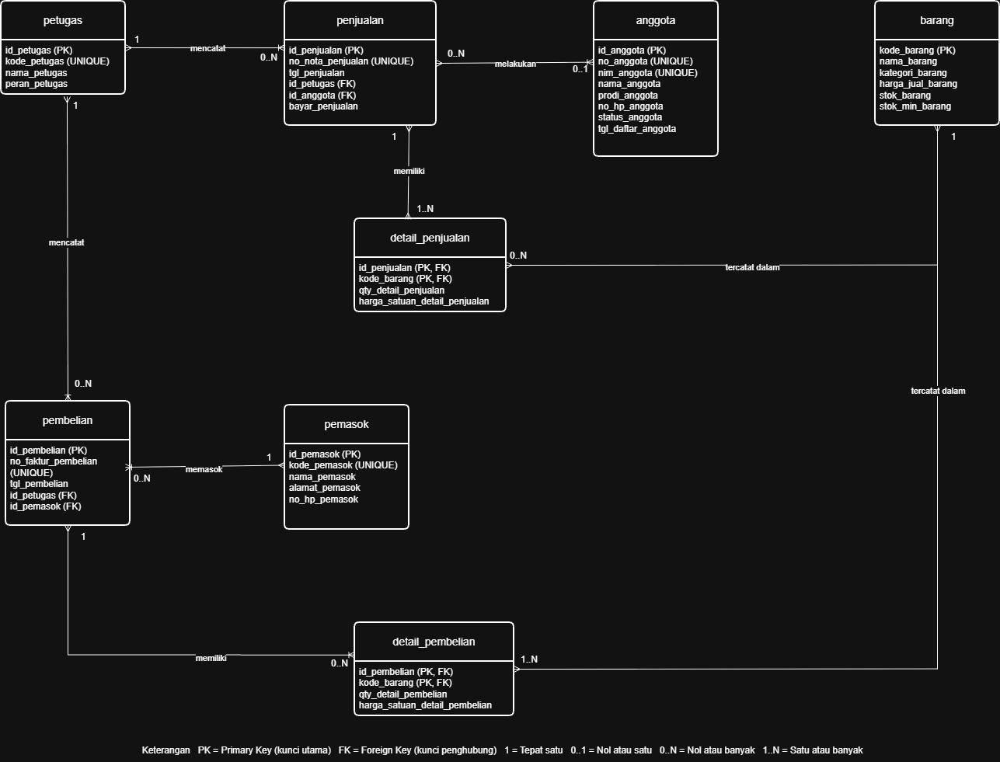
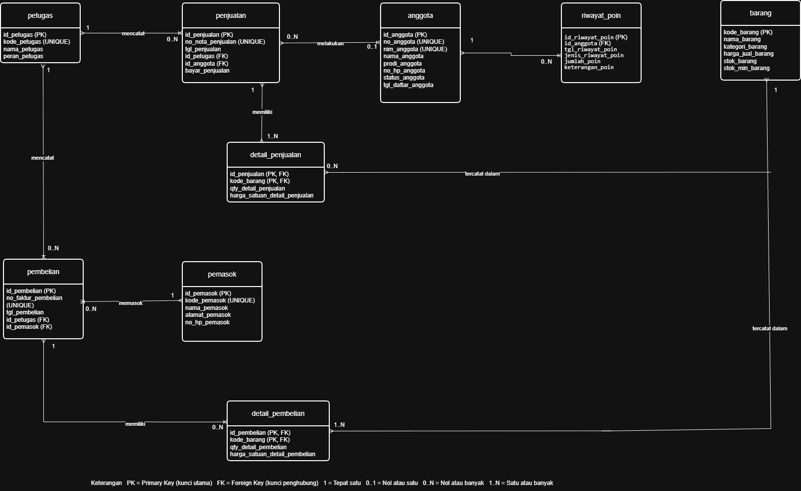
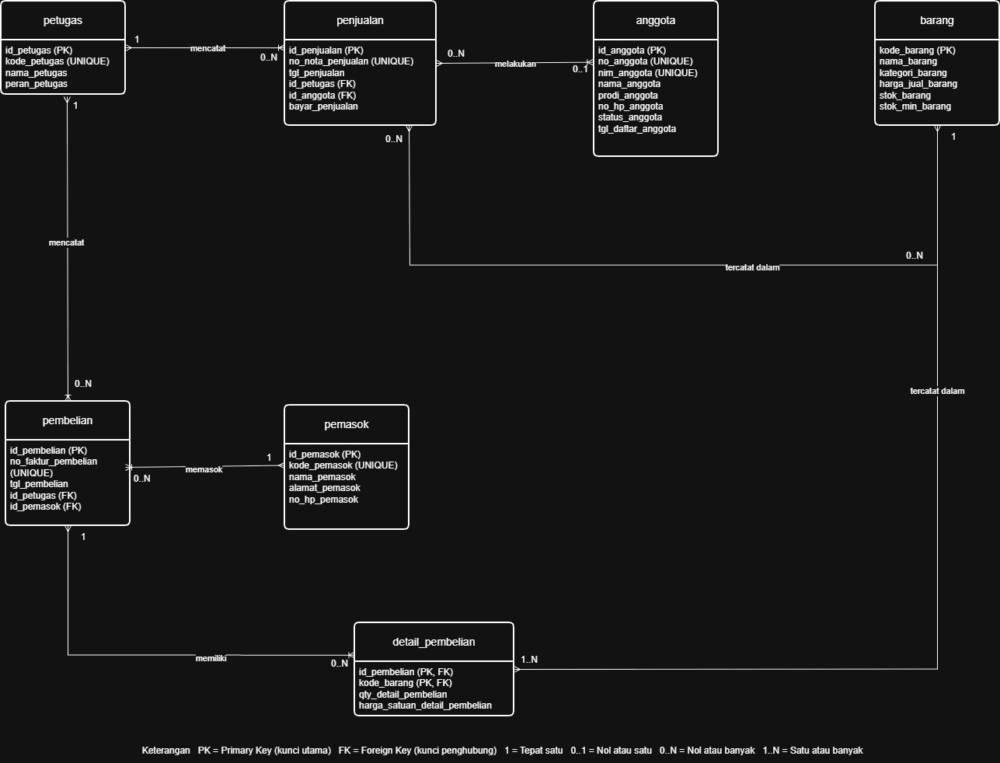
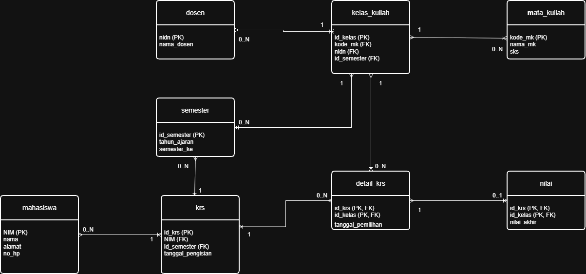

## Laporan Praktikum Basis Data - Pertemuan 3
**Nama** : Divva Ramadhan Puja Pratama

**NPM** : 25430077

**Kelas** : C

**Tanggal** : 13 Oktober 2026

**Dosen Pengampu** : Dedi Irawan, S.Kom., M.Kom.

## 1. Tujuan praktikum

Praktikum ini bertujuan untuk memahami cara membuat ERD, mulai dari menentukan entitas, atribut, kunci, sampai hubungan antarentitas. Selain itu, praktikum ini juga membantu memahami kardinalitas dan penggunaan entitas asosiatif. Hasilnya digunakan untuk membuat ERD proyek Sistem Informasi Akademik sesuai kebutuhan data dan aturan bisnis yang sudah dibuat pada modul sebelumnya.

## 2. Ringkasan Dasar Teori

ERD adalah diagram untuk menggambarkan data dan hubungan antar data dalam sebuah sistem. ERD terdiri dari entitas, atribut, primary key, foreign key, dan kardinalitas.

Entitas adalah objek yang datanya disimpan, sedangkan atribut merupakan keterangan dari entitas. Primary key digunakan sebagai identitas unik data, dan foreign key digunakan untuk menghubungkan data antarentitas. Kardinalitas menunjukkan jumlah hubungan antarentitas. Dengan ERD, rancangan basis data jadi lebih mudah dipahami sebelum dibuat menjadi tabel.

## 3. ## Hasil Langkah Percobaan

### 3.1 ERD Koperasi Mahasiswa (Kopma)

Pada percobaan ini, saya membuat ERD Kopma dengan menentukan entitas, atribut, primary key, foreign key, serta hubungan antarentitas dan kardinalitasnya.

*Gambar: ERD Koperasi Mahasiswa (Kopma).*

### 3.2 Memvalidasi ERD terhadap Kebutuhan Informasi
**Catatan Tinjauan Klien (Sementara)**

| No. | Umpan Balik | Keputusan | Alasan |
|---|---|---|---|
| 1 | Hubungan penjualan dengan detail penjualan perlu diperiksa agar setiap nota memiliki rincian barang. | Diterima | Setiap penjualan harus memiliki minimal satu detail penjualan. |
| 2 | Data poin loyalitas anggota belum ada pada ERD. | Diterima | ERD perlu menyesuaikan kebutuhan poin loyalitas anggota. |

## 4. Jawaban Titik Analisis

### Titik Analisis 1

Entitas asosiatif detail_penjualan diperlukan untuk menghubungkan penjualan dengan barang. Entitas ini juga digunakan untuk menyimpan jumlah barang yang dibeli dan harga satuan barang saat transaksi. Dengan begitu, satu nota bisa berisi beberapa jenis barang dan satu barang bisa muncul di banyak nota.

### Titik Analisis 2

Hubungan penjualan dengan detail_penjualan harus memiliki kardinalitas satu atau banyak karena setiap penjualan harus mempunyai minimal satu rincian barang. Aturan ini berasal dari proses penjualan, yaitu setiap nota mencatat barang yang dibeli. Namun, aturan minimal satu detail tidak cukup dijaga hanya dengan struktur tabel biasa. Aturan tersebut perlu dijaga melalui proses transaksi, yang akan dipelajari pada Modul 14.

### Titik Analisis 3

Dari ERD Kopma kamu, sudah ada relasi petugas dengan pembelian, dan pemasok dengan pembelian. Jadi jalurnya:

petugas → pembelian ← pemasok

Artinya, ERD dapat menjawab pertanyaan tersebut, karena data petugas dan pemasok terhubung melalui entitas pembelian.

## 5. Hasil Latihan dan Modifikasi

### E.1 Menambahkan Poin Loyalitas

Dipilih entitas riwayat_poin karena Kopma perlu mengetahui jumlah poin setiap anggota dan anggota yang memenuhi syarat penukaran. Dengan riwayat poin, penambahan dan penggunaan poin dapat dicatat sehingga perubahan poin bisa diketahui.

### E.2 Relasi Penjualan dan Barang Tanpa Entitas Asosiatif

Pada latihan ini, entitas penjualan dihubungkan langsung dengan barang tanpa menggunakan detail_penjualan. Namun, cara ini memiliki kekurangan karena jumlah barang yang dibeli dan harga saat transaksi tidak bisa dicatat dengan baik. Karena itu, detail_penjualan tetap dibutuhkan untuk menyimpan rincian barang dalam setiap transaksi.

## 6. Tugas Mandiri: Proyek Sistem Informasi Akademik

### 6.1 Membuat ERD Proyek

Pada bagian ini, saya membuat ERD untuk Sistem Informasi Akademik dari DIVRA Technologies. ERD dibuat berdasarkan kebutuhan data dan aturan bisnis. Diagram ini terdiri dari delapan entitas yang saling berhubungan untuk mengelola data mahasiswa, mata kuliah, dosen, semester, kelas kuliah, KRS, detail KRS, dan nilai.

### 6.2 Hubungan Antarentitas dan Kardinalitas

Setiap hubungan pada ERD dibuat sesuai aturan bisnis yang sudah ditentukan. Berikut hubungan antarentitas beserta aturan bisnis yang mendasarinya.

| No. | Hubungan Entitas | Kardinalitas | Aturan Bisnis |
|---|---|---|---|
| 1 | Mata Kuliah – Kelas Kuliah | 1 : 0..N | AB-03, AB-04 |
| 2 | Dosen – Kelas Kuliah | 1 : 0..N | AB-04 |
| 3 | Semester – Kelas Kuliah | 1 : 0..N | AB-04 |
| 4 | Mahasiswa – KRS | 1 : 0..N | AB-05 |
| 5 | Semester – KRS | 1 : 0..N | AB-05 |
| 6 | KRS – Detail KRS | 1 : 0..N | AB-05, AB-06 |
| 7 | Kelas Kuliah – Detail KRS | 1 : 0..N | AB-05, AB-06 |
| 8 | Detail KRS – Nilai | 1 : 0..1 | AB-07, AB-08 |

### 6.3 Hubungan Entitas dengan Kebutuhan Informasi

Entitas dalam ERD juga disesuaikan dengan kebutuhan informasi yang sudah dibuat pada Modul 2.

| Kebutuhan Informasi | Entitas yang Digunakan |
|---|---|
| KI-01 Data mahasiswa | Mahasiswa |
| KI-02 Katalog mata kuliah dan SKS | Mata Kuliah |
| KI-03 Jadwal kelas per semester | Kelas Kuliah, Mata Kuliah, Dosen, Semester |
| KI-04 Mata kuliah dalam KRS mahasiswa | Mahasiswa, KRS, Detail KRS, Kelas Kuliah, Mata Kuliah, Semester |
| KI-05 Total SKS mahasiswa | Mahasiswa, KRS, Detail KRS, Kelas Kuliah, Mata Kuliah, Semester |
| KI-06 Nilai mahasiswa | Mahasiswa, KRS, Detail KRS, Kelas Kuliah, Mata Kuliah, Nilai |
| KI-07 Daftar mahasiswa dalam kelas | Dosen, Kelas Kuliah, Mata Kuliah, Detail KRS, KRS, Mahasiswa |
| KI-08 Rekap nilai per semester | Mahasiswa, KRS, Semester, Detail KRS, Kelas Kuliah, Mata Kuliah, Nilai |

### 6.4 Entitas Asosiatif

Saya menggunakan entitas detail_krs sebagai penghubung antara krs dan kelas_kuliah. Entitas ini diperlukan karena satu KRS dapat berisi beberapa kelas kuliah. Saya juga menambahkan atribut tanggal_pemilihan untuk mencatat tanggal mahasiswa memilih kelas tersebut.

### 6.5 Catatan Tinjauan Klien

Tinjauan dilakukan untuk melihat apakah hubungan antarentitas pada ERD sudah sesuai dengan kebutuhan sistem.

| No. | Umpan Balik | Keputusan | Alasan |
|---|---|---|---|
| 1 | Hubungan KRS dan kelas kuliah perlu menggunakan detail_krs. | Diterima | Satu KRS dapat berisi beberapa kelas kuliah. |
| 2 | Nilai perlu dihubungkan dengan detail_krs. | Diterima | Nilai dapat dikaitkan dengan kelas yang diambil mahasiswa. |

## 7. Pembahasan dan Kendala

Pada praktikum ini, saya belajar membuat ERD dengan menentukan entitas, atribut, kunci, dan hubungan antarentitas. Saya juga belajar menggunakan kardinalitas dan entitas asosiatif agar hubungan data lebih jelas.

Kendala yang saya temui adalah menentukan hubungan yang tepat antarentitas. terus menetapkan tiap2 kunci.

## 8. Kesimpulan

Berdasarkan praktikum Modul 3, saya belajar membuat ERD berdasarkan dokumen kebutuhan data yang sudah dibuat pada Modul 2. Dalam proses ini, saya menentukan entitas, atribut, kunci, serta hubungan dan kardinalitas antarentitas sesuai proses bisnis yang ada.

Saya juga belajar bahwa setiap relasi harus memiliki alasan yang jelas dan sesuai dengan kebutuhan informasi.

## 9. Pernyataan Penggunaan AI

Saya menggunakan chatgpt untuk membantu memahami materi Modul 3, terutama dalam pembuatan ERD, menentukan hubungan antarentitas, dan memahami kardinalitas. AI juga membantu menjelaskan bagian yang masih membingungkan serta memeriksa kembali apakah rancangan ERD sudah sesuai dengan kebutuhan data pada Modul 2.

## 10. Bukti Git 
Tautan repository:https://github.com/DivvaRPP/basisdata.25430077

git commit : p03: milestone proyek 3

Hash commit: 

# CHECKLIST PRAKTIKUM

## A. Checklist Umum

| No. | Butir | Yang Harus Ada | Status |
|:---:|---|---|:---:|
| 1 | **Identitas** | Nama, NIM, kelas, pertemuan ke-N, tanggal pelaksanaan, nama asisten/dosen | ☑ |
| 2 | **Tujuan** | Tujuan praktikum ditulis ulang dengan bahasa sendiri (maksimal 5 baris) | ☑ |
| 3 | **Ringkasan Teori** | Pemahaman sendiri atas Dasar Teori, maksimal setengah halaman, tanpa menyalin buku | ☑ |
| 4 | **Langkah Percobaan (D)** | Tangkapan layar hasil langkah kunci sesuai checklist khusus, masing-masing diberi keterangan singkat | ☑ |
| 5 | **Titik Analisis** | Semua Titik Analisis dijawab lengkap dengan alasan, bukan sekadar ya/tidak | ☑ |
| 6 | **Latihan (E)** | Skrip/dokumen hasil latihan beserta bukti berjalan | ☑ |
| 7 | **Tugas Mandiri (F)** | Milestone proyek pertemuan ini: berkas, bukti, dan penjelasan keputusan desain | ☑ |
| 8 | **Pembahasan dan Kendala** | Galat yang ditemui, cara membacanya, dan cara mengatasinya | ☑ |
| 9 | **Kesimpulan** | Dua sampai empat kalimat dengan bahasa sendiri | ☑ |
| 10 | **Pernyataan Penggunaan AI** | Alat yang dipakai, untuk apa, dan bagian mana | ☑ |
| 11 | **Bukti Git** | Tautan repositori dan kode commit (hash) pertemuan ini dengan pesan `pNN: ...` | ☑ |
| 12 | **Keaslian** | Setiap tangkapan layar memperlihatkan akun ber-NIM dan jam sistem; nama objek memuat NIM/inisial | ☑ |

---

| Jenis | Yang harus ada |
|---|---|
| ☑ Berkas wajib | `p03_erd_kopma_<NIM>` dan `p03_erd_<NIM>` (gambar dan berkas sumber diagram) |
| ☑ Bukti tangkapan layar | ERD di draw.io dengan kardinalitas yang terbaca dan catatan tinjauan klien |
| ☑ Analisis wajib | Pemetaan setiap entitas ke PB/KI dari Pertemuan 2 dan alasan kardinalitas relasi utama |