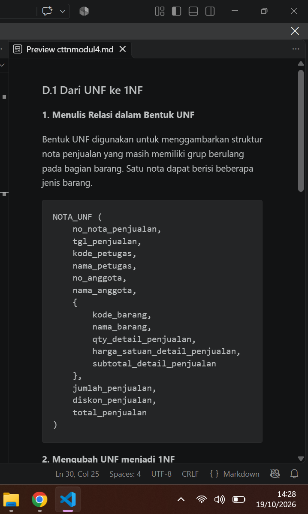
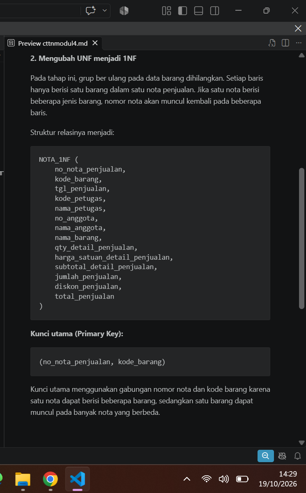
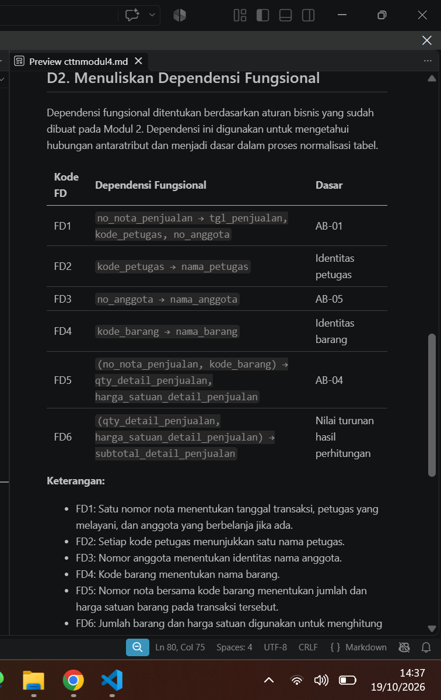
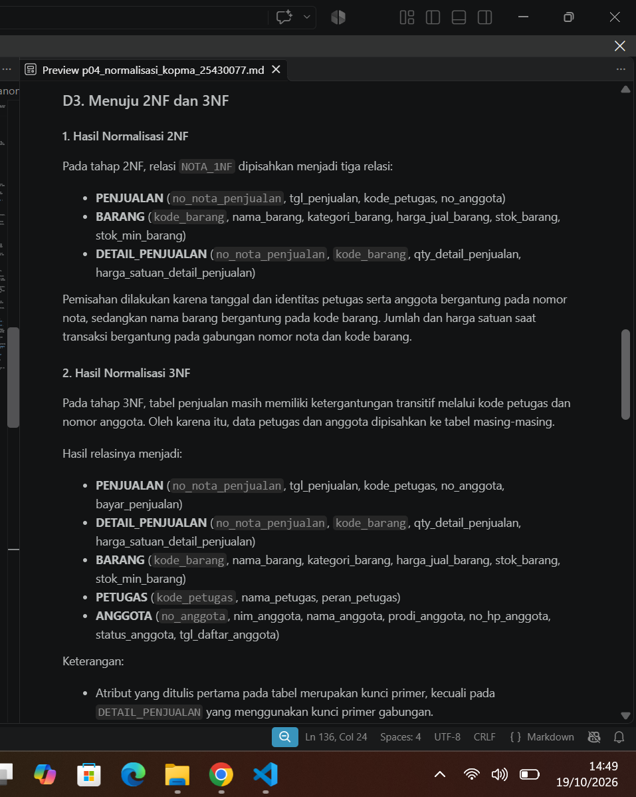
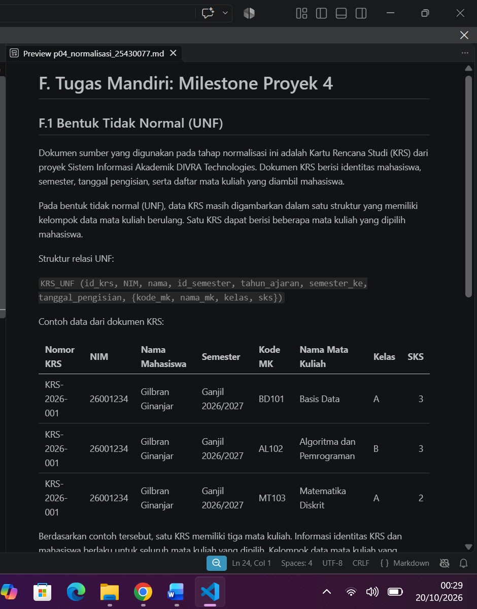
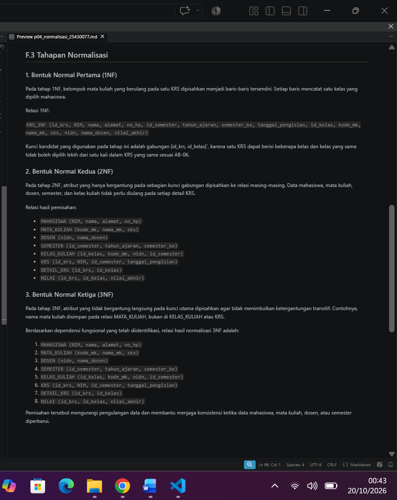
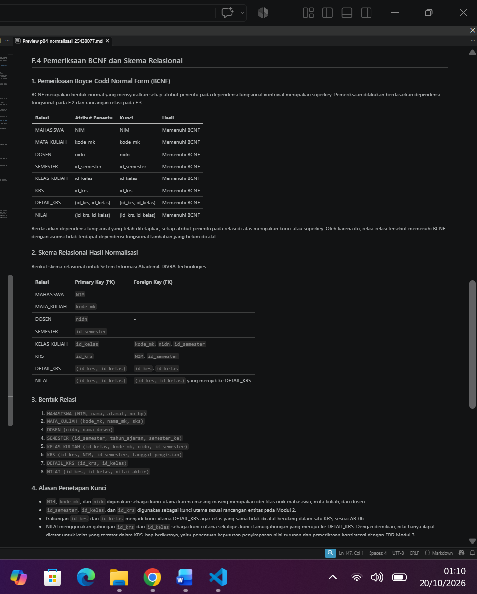

## Laporan Praktikum Basis Data - Pertemuan 4
**Nama** : Divva Ramadhan Puja Pratama

**NPM** : 25430077

**Kelas** : C

**Tanggal** : 20 Oktober 2026

**Dosen Pengampu** : Dedi Irawan, S.Kom., M.Kom.

## 1. Tujuan Praktikum

Praktikum ini bertujuan untuk memahami proses normalisasi database agar data tersusun dengan baik dan tidak menimbulkan masalah saat data ditambah, diubah, atau dihapus. Selain itu, praktikum ini melatih penentuan ketergantungan fungsional, normalisasi hingga 3NF, pemeriksaan BCNF.

## 2. Ringkasan Dasar Teori

Normalisasi adalah proses mengatur tabel database agar data tidak berulang dan terhindar dari masalah saat data ditambah, diubah, atau dihapus.

Normalisasi dilakukan melalui 1NF, 2NF, dan 3NF, serta pemeriksaan BCNF. Proses ini menggunakan ketergantungan fungsional untuk menentukan hubungan antaratribut sehingga menghasilkan tabel yang terstruktur dengan PK dan FK yang sesuai.

## 3. Hasil Langkah Percobaan

### 3.1 Mengubah UNF menjadi 1NF
Data nota penjualan Kopma yang awalnya masih memiliki kelompok data barang berulang diubah menjadi 1NF. Setiap barang dibuat dalam baris tersendiri agar nilainya lebih teratur.




### 3.2 Menentukan Ketergantungan Fungsional
Ketergantungan fungsional ditentukan berdasarkan aturan bisnis Kopma. Tahap ini membantu mengetahui atribut yang saling bergantung dan menjadi dasar pemisahan tabel.


### 3.3 Melakukan Normalisasi hingga 3NF
Data dinormalisasi secara bertahap ke 2NF dan 3NF dengan memisahkan atribut yang tidak bergantung sepenuhnya pada kunci atau masih memiliki ketergantungan transitif.


## 4. Jawaban Titik Analisis

### 4.1 Titik Analisis 1

Harga satuan disimpan pada kunci gabungan no_nota_penjualan dan `kode_barang karena harga barang saat transaksi bisa berbeda dari harga yang berlaku sekarang. Jika harga satuan hanya disimpan di tabel barang, perubahan harga dapat membuat laporan omzet tahun lalu ikut berubah dan tidak lagi sesuai dengan transaksi sebenarnya.

### 4.2 Titik Analisis 2

Total penjualan tidak disimpan pada tabel operasional karena nilainya bisa dihitung dari detail barang dan aturan diskon anggota. Dengan begitu, total selalu mengikuti rincian transaksi. Sementara itu, data arsip perlu menyimpan total jika berfungsi sebagai catatan historis yang harus tetap sama meskipun data operasional berubah.

### 4.3 Titik Analisis 3

Informasi pemasok disimpan pada tabel pembelian melalui relasi ke tabel `pemasok, bukan langsung pada tabel barang. Cara ini memungkinkan satu barang dibeli dari pemasok yang berbeda. Selain itu, Kopma dapat mengganti pemasok tanpa harus mengubah data barang, dan riwayat pembelian tetap dapat ditelusuri.

## 5. Hasil Latihan dan Modifikasi

### 5.1 Memisahkan Nomor Telepon Pemasok

Agar satu pemasok dapat memiliki beberapa nomor telepon, nomor telepon dipisahkan ke tabel baru bernama telepon_pemasok`. Tabel ini dihubungkan dengan tabel pemasok menggunakan id_pemasok.

Relasi yang digunakan:

- `pemasok` (`id_pemasok`, `nama_pemasok`, `alamat_pemasok`)
- `telepon_pemasok` (`id_pemasok`, `telepon_pemasok`)

Dengan pemisahan ini, satu pemasok dapat memiliki lebih dari satu nomor telepon tanpa harus menambahkan kolom telepon berulang pada tabel `pemasok`.

### 5.2 Anomali Ubah pada Nama Anggota

Jika `nama_anggota` disimpan di tabel `penjualan`, nama anggota yang sama dapat tercatat berulang pada banyak transaksi. Contohnya, anggota A-001 bernama Gilbran melakukan dua transaksi. Jika namanya berubah menjadi Gilbran, nama tersebut harus diubah pada setiap baris transaksi. Jika ada baris yang terlewat, data menjadi tidak konsisten.

Contoh kueri yang menunjukkan perubahan nama:

```sql
UPDATE penjualan
SET nama_anggota = 'Gilbran'
WHERE no_anggota = 'A-001';
```
Kondisi ini menunjukkan anomali ubah karena satu informasi disimpan berulang. Untuk menghindarinya, `nama_anggota` sebaiknya disimpan pada tabel `anggota`, sedangkan tabel `penjualan` cukup menyimpan referensi `id_anggota`.

## 6. Tugas Mandiri: Milestone Proyek 4

### 6.1 Dokumen Sumber dan UNF
Data KRS dijadikan dokumen sumber untuk proses normalisasi karena memuat data mahasiswa, semester, dan mata kuliah yang dipilih.


### 6.2 Tahapan Normalisasi
Data dinormalisasi secara bertahap dari 1NF hingga 3NF agar data lebih terstruktur dan mengurangi pengulangan.


### 6.3 Pemeriksaan BCNF
Skema diperiksa untuk memastikan setiap penentu merupakan kunci kandidat sesuai aturan BCNF.


### 6.4 Nilai Turunan
Total SKS dihitung dari mata kuliah yang dipilih mahasiswa, sehingga tidak perlu disimpan sebagai nilai tetap.

## 7. Pembahasan dan Kendala
Kendala dalam praktikum ini adalah menentukan ketergantungan fungsional dan memisahkan atribut ke tabel yang sesuai.Pembahasanny Normalisasi membantu menyusun data agar lebih teratur, mengurangi pengulangan, dan menjaga konsistensi data.

## 8. Kesimpulan
Praktikum ini membantu memahami proses normalisasi database dari UNF hingga 3NF serta pemeriksaan BCNF. Dengan normalisasi, data dapat disusun ke dalam tabel yang lebih terstruktur.

## 9. Pernyataan Penggunaan AI
Chatgpt digunakan sebagai alat bantu untuk memahami materi normalisasi. Hasil akhir tetap diperiksa dan disesuaikan dengan materi praktikum.

## 10. Bukti Git 
Tautan repository:https://github.com/DivvaRPP/basisdata.25430077

git commit : p04: milestone proyek 4

Hash commit: 

# CHECKLIST PRAKTIKUM

## A. Checklist Umum

| No. | Butir | Yang Harus Ada | Status |
|:---:|---|---|:---:|
| 1 | **Identitas** | Nama, NIM, kelas, pertemuan ke-N, tanggal pelaksanaan, nama asisten/dosen | ☑ |
| 2 | **Tujuan** | Tujuan praktikum ditulis ulang dengan bahasa sendiri (maksimal 5 baris) | ☑ |
| 3 | **Ringkasan Teori** | Pemahaman sendiri atas Dasar Teori, maksimal setengah halaman, tanpa menyalin buku | ☑ |
| 4 | **Langkah Percobaan (D)** | Tangkapan layar hasil langkah kunci sesuai checklist khusus, masing-masing diberi keterangan singkat | ☑ |
| 5 | **Titik Analisis** | Semua Titik Analisis dijawab lengkap dengan alasan, bukan sekadar ya/tidak | ☑ |
| 6 | **Latihan (E)** | Skrip/dokumen hasil latihan beserta bukti berjalan | ☑ |
| 7 | **Tugas Mandiri (F)** | Milestone proyek pertemuan ini: berkas, bukti, dan penjelasan keputusan desain | ☑ |
| 8 | **Pembahasan dan Kendala** | Galat yang ditemui, cara membacanya, dan cara mengatasinya | ☑ |
| 9 | **Kesimpulan** | Dua sampai empat kalimat dengan bahasa sendiri | ☑ |
| 10 | **Pernyataan Penggunaan AI** | Alat yang dipakai, untuk apa, dan bagian mana | ☑ |
| 11 | **Bukti Git** | Tautan repositori dan kode commit (hash) pertemuan ini dengan pesan `pNN: ...` | ☑ |
| 12 | **Keaslian** | Setiap tangkapan layar memperlihatkan akun ber-NIM dan jam sistem; nama objek memuat NIM/inisial | ☑ |

---

| Jenis | Yang harus ada |
|---|---|
| ☑ Berkas wajib | p04_normalisasi_<NIM>.md (proyek) |
| ☑ Bukti tangkapan layar | Tabel tahapan UNF → 1NF → 2NF → 3NF |
| ☑ Analisis wajib | Daftar dependensi fungsional keputusan menyimpan atau menghitung nilai turunan beserta alasannya |
