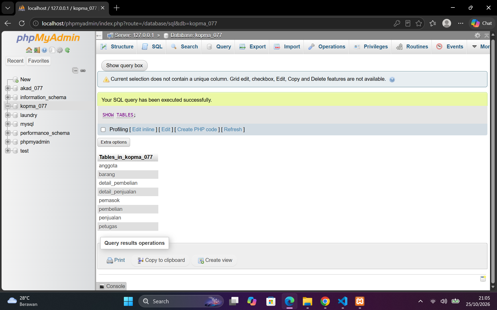
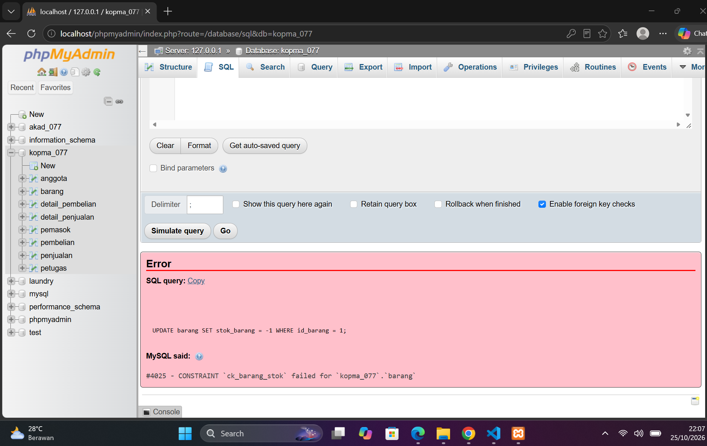
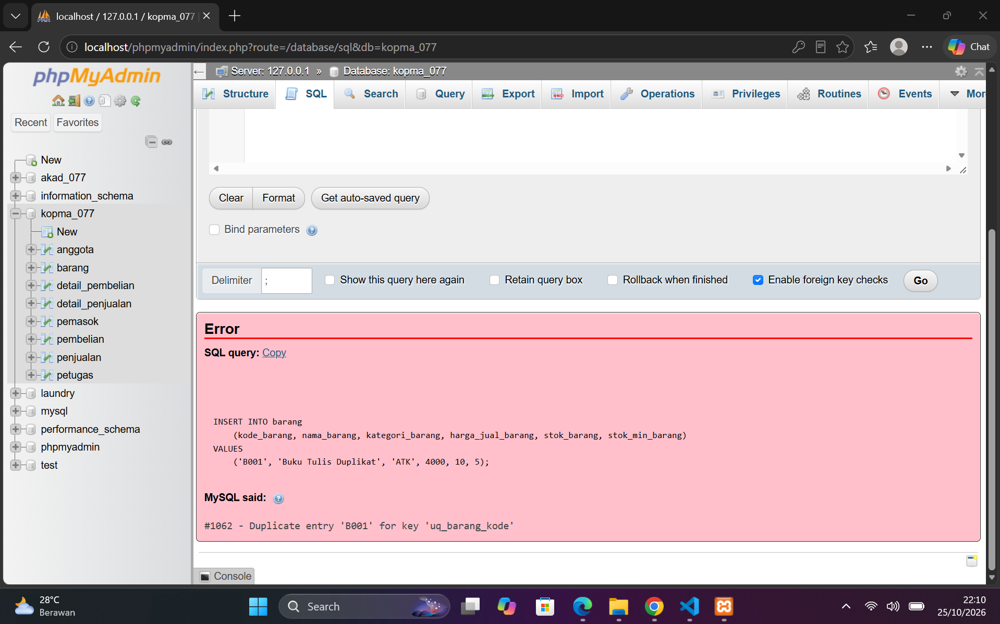
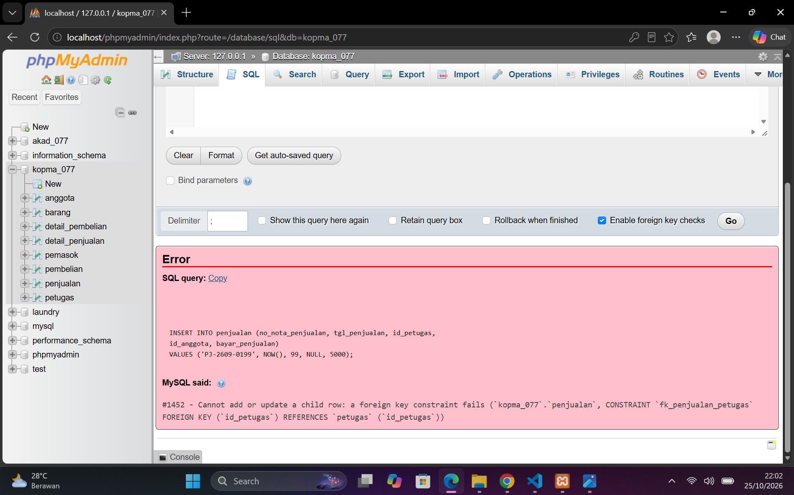
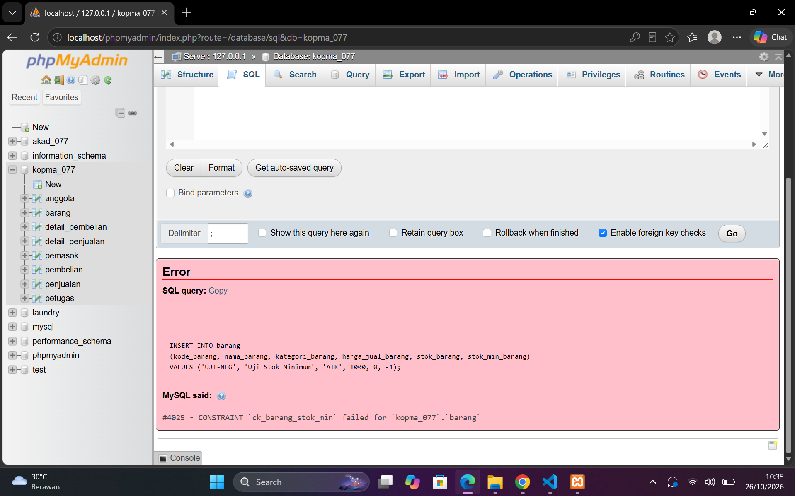
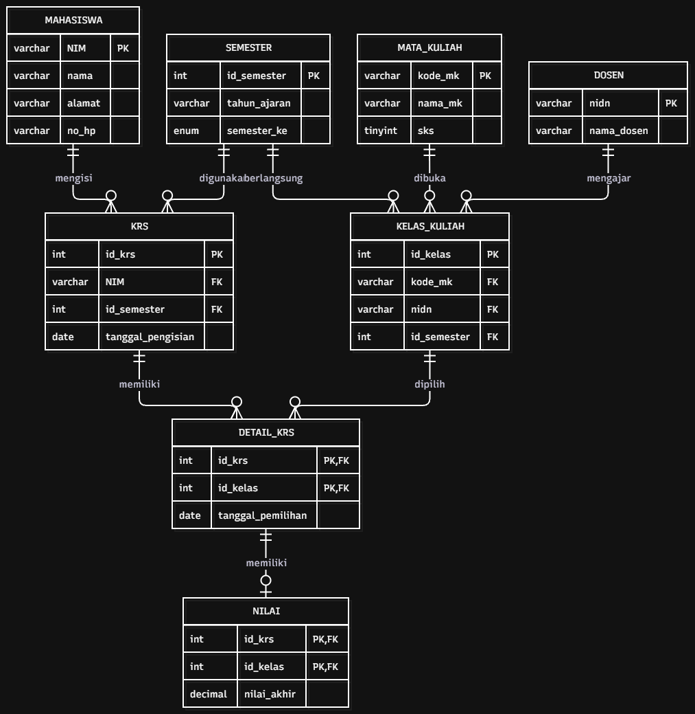

## Laporan Praktikum Basis Data - Pertemuan 5
**Nama** : Divva Ramadhan Puja Pratama

**NPM** : 25430077

**Kelas** : C

**Tanggal** : 27 Oktober 2026

**Dosen Pengampu** : Dedi Irawan, S.Kom., M.Kom.

# 1. Tujuan Praktikum
Praktikum Modul 5 bertujuan untuk mempelajari pembuatan struktur basis data menggunakan SQL DDL, mulai dari membuat tabel, menentukan primary key dan foreign key, hingga menambahkan constraint untuk menjaga konsistensi data.

Selain itu, praktikum ini bertujuan untuk menerapkan aturan bisnis ke dalam struktur basis data Kopma dan proyek Sistem Informasi Akademik, serta memahami pemilihan tipe data dan pembuatan ERD fisik agar sesuai dengan kebutuhan data yang telah dirancang.

# 2. Ringkasan Dasar Teori
DDL adalah perintah SQL untuk membuat dan mengatur struktur database, seperti tabel dan hubungan antar tabel.

Primary Key (PK) digunakan sebagai identitas unik setiap data, sedangkan Foreign Key (FK) menghubungkan satu tabel dengan tabel lainnya. Constraint digunakan untuk menjaga agar data yang dimasukkan sesuai dengan aturan yang sudah ditentukan.

Tipe data dipilih sesuai kebutuhan, misalnya `VARCHAR` untuk teks, `INT` untuk bilangan bulat, dan `DATE` untuk tanggal. ERD fisik digunakan untuk menggambarkan tabel, kolom, serta hubungan antar tabel dalam database.

# 3. Hasil Langkah Percobaan

## 3.1 Membuat Struktur Tabel Database Kopma

Pada langkah ini, saya membuat tabel-tabel database Kopma menggunakan perintah SQL DDL di file `p05_ddl_kopma_25430077.sql`. Tabel dibuat sesuai rancangan ERD yang telah dikerjakan pada modul sebelumnya. 

## 3.2 Menguji Constraint
Pada langkah ini, saya menguji constraint untuk memastikan database menolak data yang melanggar aturan.

**1. Pengujian CHECK — Error 4025**
Saya mencoba mengubah stok barang menjadi `-1`. Database menolak perubahan karena constraint `ck_barang_stok` mensyaratkan stok tidak boleh negatif.

**2. Pengujian UNIQUE — Error 1062**
Saya mencoba menambahkan barang dengan kode `B001` yang sudah digunakan. Database menolak data tersebut karena kolom kode barang memiliki constraint UNIQUE.

**3. Pengujian Foreign Key — **
Error 1452
Saya mencoba menambahkan penjualan dengan `id_petugas` bernilai `99`, sedangkan petugas dengan ID tersebut tidak tersedia pada tabel `petugas`. Database menolak transaksi karena foreign key tidak menemukan data yang sesuai pada tabel induk.

## 3.3 Membaca ERD Fisik: Fungsi Setiap Tabel
Database Kopma memiliki delapan tabel yang dibagi menjadi tabel master, kepala transaksi, dan detail transaksi.

Tabel master terdiri dari `petugas`, `anggota`, `barang`, dan `pemasok`. Tabel `penjualan` dan `pembelian` menyimpan data utama transaksi, sedangkan `detail_penjualan` dan `detail_pembelian` menyimpan rincian barang pada masing-masing transaksi.

Pembagian ini membantu menjelaskan fungsi setiap tabel serta hubungan antar tabel dalam database Kopma.

# 4. Titik Analisis

## 4.1 Penggunaan Harga Barang

Harga barang pada detail penjualan perlu disimpan saat transaksi dilakukan. Dengan begitu, jika harga barang berubah, harga pada transaksi lama tetap sesuai dengan harga saat penjualan terjadi.

## 4.2 Analisis Tiga Galat

Dari pengujian yang dilakukan, terdapat tiga galat yang menunjukkan bahwa constraint bekerja sesuai fungsinya.

1. **Error 1452 (Foreign Key)**
   Galat ini muncul karena transaksi menggunakan `id_petugas` bernilai `99`, sedangkan data petugas tersebut tidak tersedia di tabel `petugas`. Foreign key menjaga agar transaksi hanya terhubung dengan petugas yang terdaftar.
2. **Error 4025 (CHECK)**
   Galat ini muncul ketika stok barang diubah menjadi `-1`. Constraint `ck_barang_stok` menolak nilai tersebut agar stok barang tidak menjadi negatif.
3. **Error 1062 (UNIQUE)**
   Galat ini muncul karena kode barang `B001` sudah digunakan. Constraint `uq_barang_kode` mencegah kode barang yang sama digunakan lebih dari satu kali.

## 4.3 Urutan Penghapusan Tabel
Jika tabel induk dihapus terlebih dahulu saat masih digunakan oleh tabel anak, MariaDB dapat menolak perintah tersebut dengan galat foreign key. Oleh karena itu, tabel dihapus dari bagian yang memiliki hubungan paling bergantung terlebih dahulu agar skrip DDL dapat dijalankan ulang dengan benar.

# 5. Latihan dan Modifikasi

## 5.1 Menambahkan Constraint CHECK
Pada latihan ini, saya menambahkan constraint CHECK pada kolom stok_min_barang agar nilainya tidak boleh negatif.
Saya mencoba memasukkan data dengan nilai stok minimum -1. Database menolak data tersebut dan menampilkan error 4025. Hal ini menunjukkan bahwa constraint berhasil mencegah nilai stok minimum yang tidak sesuai aturan.

## 5.2 Mengubah Aturan Foreign Key
Pada latihan ini, saya mengubah aturan foreign key antara tabel `penjualan` dan `anggota` menjadi `ON DELETE SET NULL`. Perubahan dilakukan dengan menghapus aturan lama, lalu menambahkan aturan yang baru.

Kedua perintah berhasil dijalankan. Dengan aturan ini, jika data anggota dihapus, transaksi penjualan tetap tersimpan, tetapi kolom `id_anggota` menjadi `NULL`. Jadi, riwayat penjualan tidak ikut terhapus hanya karena data anggota dihapus. ad di fk_tabel_penjualan.png

# 6. Tugas Mandiri: Milestone Proyek 5
## 6.1 Pembuatan DDL
Saya membuat file `p05_ddl_25430077.sql` untuk membuat struktur database Sistem Informasi Akademik dengan nama `akad_077`. Database ini memiliki delapan tabel, yaitu `mahasiswa`, `mata_kuliah`, `dosen`, `semester`, `kelas_kuliah`, `krs`, `detail_krs`, dan `nilai`.

Setiap tabel memiliki primary key, sedangkan tabel yang saling berhubungan menggunakan foreign key. Constraint juga ditambahkan agar data tetap sesuai aturan yang sudah dibuat.

## 6.2 Pembuatan ERD Fisik
Saya membuat ERD fisik berdasarkan tabel-tabel yang ada di database. Diagram ini menunjukkan kolom, primary key, foreign key, dan hubungan antar tabel.
Dengan ERD ini, hubungan data pada Sistem Informasi Akademik jadi lebih mudah dilihat dan dipahami.

## 6.3 Tipe Data dan Perbandingan ERD
Tipe data dipilih sesuai dengan data yang disimpan. Contohnya, `VARCHAR` untuk teks, `INT` untuk bilangan bulat, `DATE` untuk tanggal, dan `DECIMAL` untuk nilai desimal.

# 7. Pembahasan dan Kendala
Selama mengerjakan Modul 5, saya belajar membuat tabel menggunakan SQL DDL, menghubungkan tabel dengan foreign key, dan menambahkan constraint untuk menjaga data.

Saat pengujian, terdapat tiga error. Error `1452` muncul karena foreign key mengacu pada data yang tidak tersedia, error `4025` karena nilai stok melanggar aturan `CHECK`, dan error `1062` karena kode barang sudah digunakan. Dari pengujian tersebut, saya jadi lebih memahami cara kerja constraint dalam menjaga data.

# 8. Kesimpulan

Praktikum Modul 5 membantu saya memahami cara membuat struktur database menggunakan SQL DDL, mulai dari membuat tabel, menentukan primary key dan foreign key, hingga menambahkan constraint untuk menjaga konsistensi data.

Melalui pengujian pada database Kopma, saya memahami bahwa constraint dapat mencegah data yang tidak sesuai aturan. Pada proyek Sistem Informasi Akademik, saya juga belajar menyusun file DDL dan ERD fisik sesuai rancangan database.

# 9. Pernyataan Penggunaan AI
Saya menggunakan chatgpt sebagai alat bantu untuk memahami materi, mencari penjelasan dari error yang muncul, dan merapikan penulisan laporan. Dari proses tersebut, saya belajar memahami fungsi setiap perintah SQL dan alasan database menolak data yang tidak sesuai aturan.

## 10. Bukti Git 
Tautan repository:https://github.com/DivvaRPP/basisdata.25430077

git commit : p05: milestone proyek 5

Hash commit: 

# CHECKLIST PRAKTIKUM

## A. Checklist Umum

| No. | Butir | Yang Harus Ada | Status |
|:---:|---|---|:---:|
| 1 | **Identitas** | Nama, NIM, kelas, pertemuan ke-N, tanggal pelaksanaan, nama asisten/dosen | ☑ |
| 2 | **Tujuan** | Tujuan praktikum ditulis ulang dengan bahasa sendiri (maksimal 5 baris) | ☑ |
| 3 | **Ringkasan Teori** | Pemahaman sendiri atas Dasar Teori, maksimal setengah halaman, tanpa menyalin buku | ☑ |
| 4 | **Langkah Percobaan (D)** | Tangkapan layar hasil langkah kunci sesuai checklist khusus, masing-masing diberi keterangan singkat | ☑ |
| 5 | **Titik Analisis** | Semua Titik Analisis dijawab lengkap dengan alasan, bukan sekadar ya/tidak | ☑ |
| 6 | **Latihan (E)** | Skrip/dokumen hasil latihan beserta bukti berjalan | ☑ |
| 7 | **Tugas Mandiri (F)** | Milestone proyek pertemuan ini: berkas, bukti, dan penjelasan keputusan desain | ☑ |
| 8 | **Pembahasan dan Kendala** | Galat yang ditemui, cara membacanya, dan cara mengatasinya | ☑ |
| 9 | **Kesimpulan** | Dua sampai empat kalimat dengan bahasa sendiri | ☑ |
| 10 | **Pernyataan Penggunaan AI** | Alat yang dipakai, untuk apa, dan bagian mana | ☑ |
| 11 | **Bukti Git** | Tautan repositori dan kode commit (hash) pertemuan ini dengan pesan `pNN: ...` | ☑ |
| 12 | **Keaslian** | Setiap tangkapan layar memperlihatkan akun ber-NIM dan jam sistem; nama objek memuat NIM/inisial | ☑ |

---

| Jenis | Yang harus ada |
|---|---|
| ☑ Berkas wajib |p05_ddl_<NIM>.sql (dapat dijalankan ulang dari basis data kosong) dan ERD fisik p05_erd_fisik_<NIM> |
| ☑ Bukti tangkapan layar | SHOW CREATE TABLE tabel utama; galat saat constraint dilanggar (FK, UNIQUE, CHECK)
 |
| ☑ Analisis wajib | Alasan pemilihan tipe data dan constraint; kaitan constraint dengan AB-xx |

