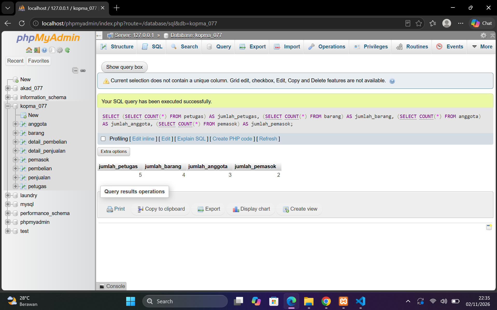
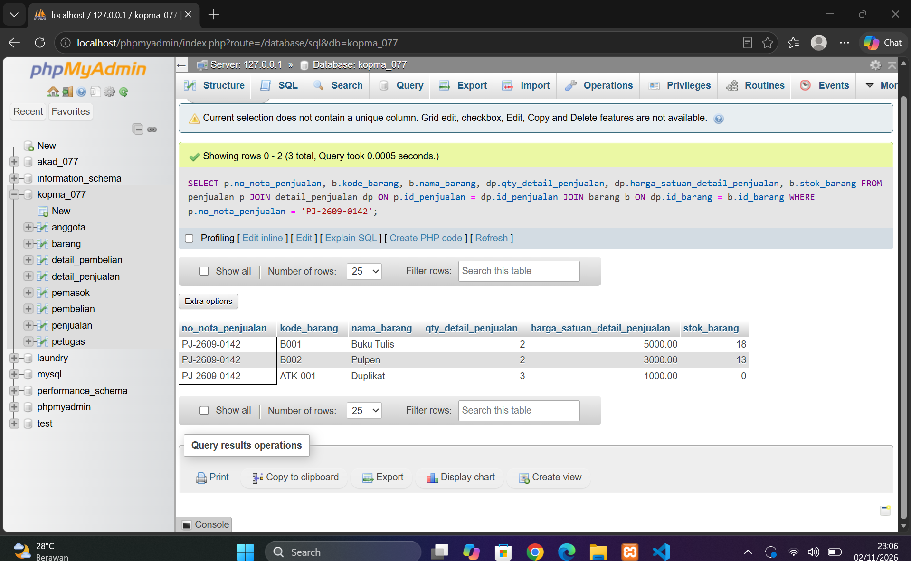
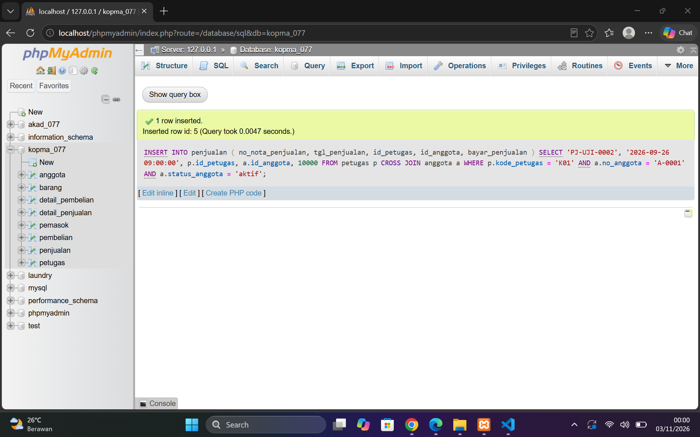
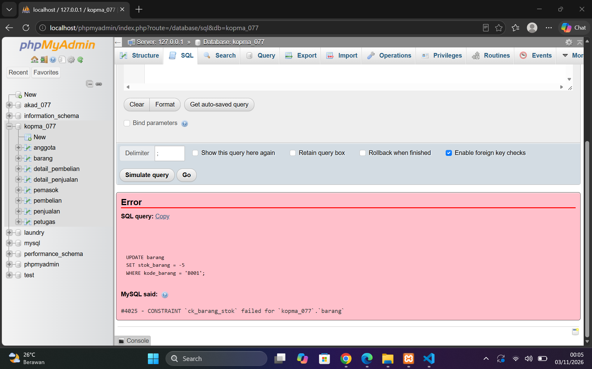
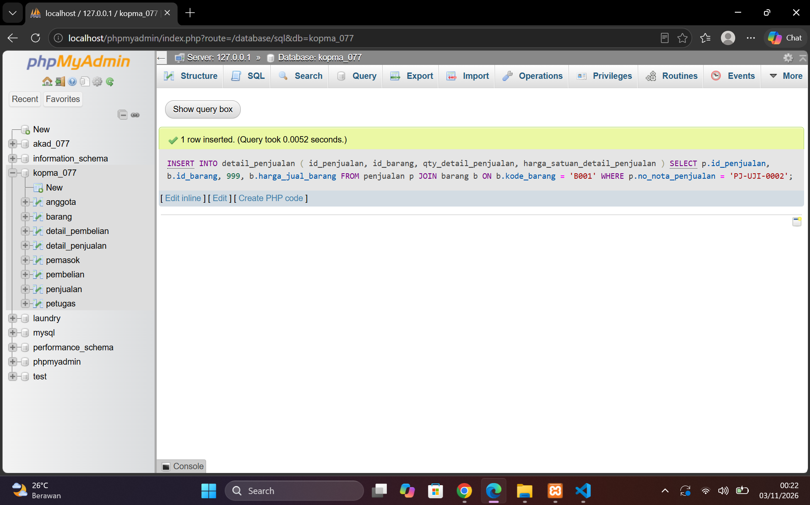

## Laporan Praktikum Basis Data - Pertemuan 6
**Nama** : Divva Ramadhan Puja Pratama

**NPM** : 25430077

**Kelas** : C

**Tanggal** : 03 November 2026

**Dosen Pengampu** : Dedi Irawan, S.Kom., M.Kom.

## 1. Tujuan Praktikum

Pada praktikum Modul 6 ini, saya belajar cara mengisi dan mengelola data di dalam database. Selain memasukkan data, saya juga mempelajari cara mengubah dan menghapus data dengan benar agar tidak terjadi kesalahan.

Melalui praktikum ini, saya juga belajar melakukan pengujian untuk melihat apakah database dapat menerima data yang benar dan menolak data yang tidak sesuai aturan. Selain itu, saya menyiapkan data sampel proyek agar bisa dimasukkan kembali menggunakan file SQL.

## 2. Ringkasan Teori

Di modul ini, saya belajar beberapa perintah SQL yang digunakan untuk mengelola data dalam database. Perintah tersebut adalah `INSERT` untuk menambahkan data, `UPDATE` untuk mengubah data, `DELETE` untuk menghapus data, dan `SELECT` untuk melihat isi tabel.

Saya juga belajar bahwa saat mengisi data, tabel induk harus diisi terlebih dahulu sebelum tabel yang terhubung dengannya. Ini penting supaya data yang dimasukkan tidak mengalami masalah dengan hubungan antar tabel.

Selain itu, saat mengubah atau menghapus data, kita harus lebih teliti agar tidak salah memilih data. Perintah `WHERE` digunakan untuk menentukan data yang ingin diubah atau dihapus. Ada juga `sql_safe_updates` yang membantu mencegah perubahan data yang tidak disengaja.

## 3. Hasil Langkah Percobaan

### 3.1 Mengisi Data Awal Kopma

Pertama, saya memasukkan data petugas, barang, anggota, dan pemasok menggunakan perintah `INSERT`.
Setelah itu, saya memeriksa setiap tabel untuk memastikan data berhasil disimpan. Hasilnya terdapat 5 petugas, 4 barang, 3 anggota, dan 2 pemasok.

### 3.2 Mencatat Transaksi Penjualan

Selanjutnya, saya membuat transaksi penjualan dengan nomor nota **PJ-2609-0142**. Transaksi tersebut berisi buku tulis, pulpen, dan barang ATK-001.
Setelah transaksi dibuat, stok barang otomatis berkurang. Stok buku tulis menjadi 18, pulpen 13, dan ATK-001 menjadi 0.

### 3.3 Mengubah dan Menghapus Data dengan Aman

Pada langkah ini, saya mencoba mengubah harga barang menggunakan `UPDATE`. Setelah mengaktifkan `sql_safe_updates`, perintah tanpa kondisi `WHERE` ditolak dengan pesan `ERROR 1175`.
Setelah menambahkan kondisi `WHERE`, perintah berhasil dijalankan. Saya juga mempelajari proses penghapusan data transaksi.

### 3.4 Melakukan Pengujian Data

Terakhir, saya menguji database menggunakan data yang sesuai dan tidak sesuai aturan.
Hasilnya, beberapa data yang salah berhasil ditolak. Namun, database masih menerima penjualan dengan jumlah melebihi stok. Artinya, aturan batas stok belum sepenuhnya diterapkan.

Hasil pengujian kemudian saya catat dalam file pengujian.

**Bukti:** Screenshot pengujian positif, negatif, dan penjualan melebihi stok.

## 4. Jawaban Titik Analisis

### 4.1 Penggunaan INSERT ... SELECT

Perintah `INSERT ... SELECT` lebih aman karena harga barang diambil langsung dari tabel barang, sehingga tidak perlu mengetik harga secara manual. Jika harga pulpen berubah menjadi Rp4.500, harga pada nota PJ-2609-0142 tetap sama karena harga saat transaksi sudah disimpan di tabel detail penjualan.

### 4.2 Penghapusan Data dengan CASCADE

Saat nota penjualan dihapus, detail penjualannya ikut terhapus karena menggunakan `ON DELETE CASCADE`. Namun, petugas yang sudah pernah melayani penjualan tidak bisa langsung dihapus karena masih terhubung dengan data transaksi.
Jika kasir berhenti bekerja, cara yang tepat adalah mengubah statusnya menjadi nonaktif agar riwayat transaksi tetap tersimpan.

### 4.3 Pengujian Penjualan Melebihi Stok

Pada pengujian yang saya lakukan, database masih menerima penjualan dengan jumlah melebihi stok yang tersedia. Hal ini terjadi karena `CHECK` pada tabel barang hanya memeriksa nilai stok, bukan membandingkannya dengan jumlah barang yang dijual.
Jadi, aturan agar jumlah penjualan tidak melebihi stok masih perlu ditambahkan. Hal ini saya catat sebagai utang desain untuk diperbaiki pada Modul 14.

## 5. Hasil Latihan dan Modifikasi

### 5.1 Mengarsipkan Anggota Nonaktif

Saya mencoba mengarsipkan anggota yang sudah tidak aktif dan terdaftar sebelum tahun 2025. Anggota yang memenuhi kondisi tersebut adalah **Budi Santoso**.

Data anggota tersebut dipindahkan ke tabel `anggota_arsip` sebelum dihapus dari tabel `anggota`. Dengan cara ini, data anggota lama tetap tersimpan sebagai arsip dan tidak langsung hilang.

### 5.2 Mengubah Harga Barang Kategori Makanan

Selanjutnya, saya menjalankan perintah `UPDATE` untuk menaikkan harga barang dengan kategori `makanan` sebesar 5%, kemudian membulatkan hasilnya ke ratusan terdekat.

Hasilnya, **0 baris terpengaruh**. Hal ini karena data barang yang tersedia pada tabel hanya memiliki kategori ATK, sehingga tidak ada barang dengan kategori `makanan` yang memenuhi kondisi tersebut.

## 6. Tugas Mandiri: Milestone Proyek 6

### 6.1 Memasukkan Data Sampel

Saya membuat file `p06_data_25430077.sql` untuk mengisi data ke database Sistem Informasi Akademik.

Data yang berhasil dimasukkan terdiri dari 15 mahasiswa, 15 mata kuliah, 5 dosen, 5 semester, 15 kelas kuliah, 15 KRS, 60 detail KRS, dan 60 data nilai.

### 6.2 Menguji Database

Setelah data dimasukkan, saya membuat file `p06_uji_25430077.md` untuk mencatat hasil pengujian database.

Saya mencoba beberapa pengujian, seperti memasukkan data yang benar, data duplikat, dan data yang tidak memiliki hubungan dengan tabel lain. Hasilnya, data yang tidak sesuai aturan berhasil ditolak.
### 6.3 Menjalankan Ulang Database

Terakhir, saya mencoba menjalankan kembali file DDL dan file data dari kondisi tabel kosong. Hasilnya, semua data berhasil dimasukkan kembali dengan jumlah yang sama.

Dari percobaan ini, saya memastikan bahwa struktur dan data database bisa dijalankan ulang dengan hasil yang tetap sama.

## 7. Pembahasan dan Kendala
Selama mengerjakan Modul 6, saya belajar bahwa data dalam database harus sesuai dengan aturan yang sudah dibuat.

Ada beberapa hasil yang saya temukan. Saat mengarsipkan anggota, data Budi Santoso berhasil dipindahkan ke tabel arsip. Namun, saat mengubah harga barang kategori makanan, tidak ada data yang berubah karena barang yang tersedia hanya memiliki kategori ATK.
Dari hasil tersebut, saya mengetahui bahwa masih ada aturan yang perlu diperbaiki agar database bisa membatasi data sesuai ketentuan.

## 8. Kesimpulan
Dari praktikum Modul 6, saya belajar cara memasukkan, mengubah, menghapus, dan menguji data menggunakan SQL. Saya juga memahami pentingnya aturan database agar data yang tidak sesuai bisa ditolak.

Melalui praktikum ini, saya berhasil mengisi data pada database Kopma dan Sistem Informasi Akademik, serta melakukan berbagai pengujian. Dari hasil pengujian, saya juga menemukan beberapa aturan yang masih perlu diperbaiki, seperti batas stok penjualan dan jumlah mata kuliah dalam satu KRS.

## 9. Pernyataan Penggunaan AI

Dalam praktikum Modul 6, saya menggunakan ChatGPT untuk membantu memahami materi, menjelaskan perintah SQL, dan mencari solusi saat mengalami kendala.

ChatGPT juga memeriksa beberapa bagian pekerjaan. Namun, proses menjalankan perintah SQL, melakukan pengujian, dan memeriksa hasilnya tetap saya lakukan sendiri.

## 10. Bukti Git 
Tautan repository:https://github.com/DivvaRPP/basisdata.25430077

git commit : p06: milestone proyek 6

Hash commit:

## Checklist Laporan Pertemuan 6
| Jenis | Yang harus ada |
|---|---|
| ☑ Berkas wajib |p06_data_<NIM>.sql (data sampel berbasis parameter P) dan p06_uji_<NIM>.md (skenario uji) |
| ☑ Bukti tangkapan layar | Hasil skenario uji positif dan negatif; jumlah baris per tabel|
| ☑ Analisis wajib | Tabel skenario uji: masukan, hasil yang diharapkan, hasil nyata, status |

