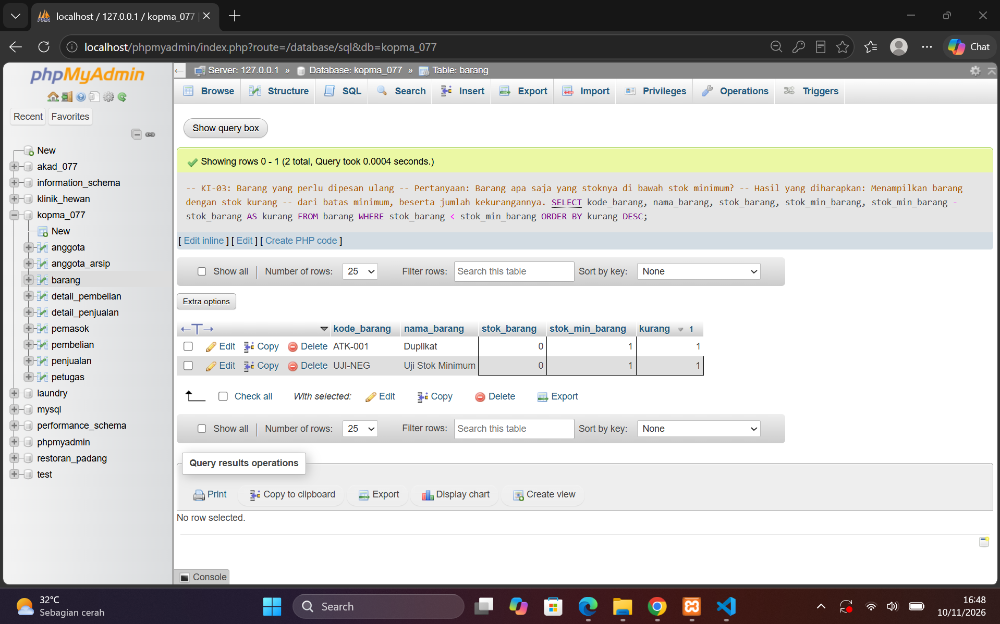
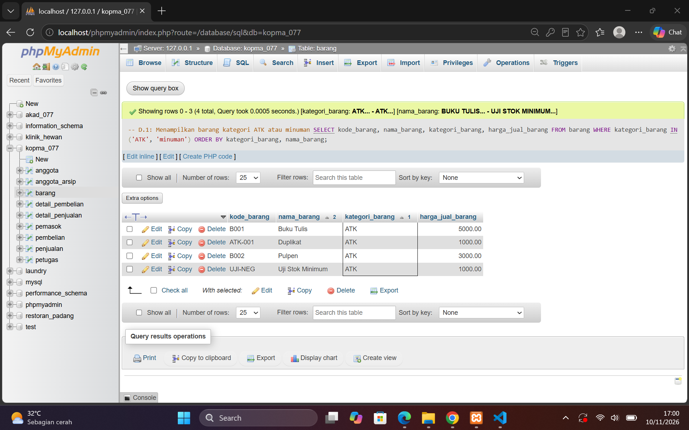
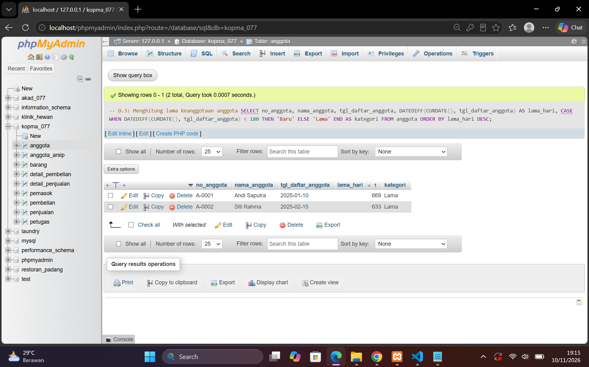
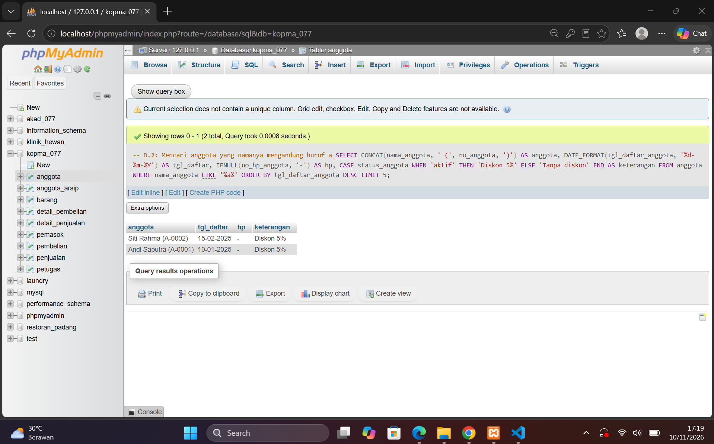
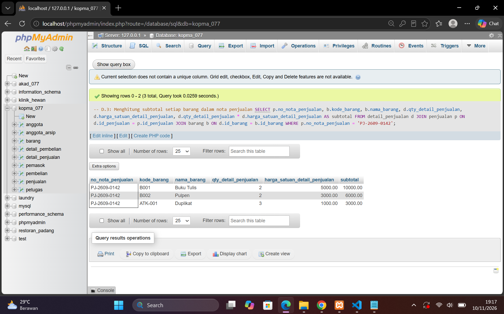

## Laporan Praktikum Basis Data - Pertemuan 7
**Nama** : Divva Ramadhan Puja Pratama

**NPM** : 25430077

**Kelas** : C

**Tanggal** : 10 November 2026

**Dosen Pengampu** : Dedi Irawan, S.Kom., M.Kom.

## 1. Tujuan Praktikum

Praktikum ini bertujuan untuk mempelajari cara mengambil dan mengolah data menggunakan perintah SQL. Selain itu, praktikum ini juga membantu saya memahami penggunaan kondisi dan fungsi SQL untuk menampilkan data sesuai kebutuhan.

Pada pertemuan ini, saya juga menerapkan materi yang dipelajari ke dalam proyek Sistem Informasi Akademik dengan membuat beberapa kueri berdasarkan kebutuhan informasi yang telah ditentukan.

## 2. Ringkasan Dasar Teori

Pada Modul 7, saya mempelajari beberapa perintah SQL untuk mencari, menyaring, dan mengolah data di dalam database.

Perintah dan fungsi yang dipelajari antara lain:

1. **WHERE** untuk memilih data berdasarkan kondisi tertentu.
2. **IN** untuk memilih data dari beberapa nilai.
3. **BETWEEN** untuk mencari data dalam rentang tertentu.
4. **IS NULL** untuk mencari data yang belum memiliki nilai.
5. **LIKE** untuk mencari teks berdasarkan pola tertentu.
6. **CONCAT** untuk menggabungkan beberapa teks.
7. **UPPER** untuk mengubah teks menjadi huruf kapital.
8. **FORMAT** untuk mengatur tampilan angka.
9. **DATE_FORMAT** untuk mengubah format tanggal.
10. **DATEDIFF** untuk menghitung selisih dua tanggal.
11. **IFNULL** untuk mengganti nilai NULL dengan nilai lain.
12. **CASE** untuk membuat hasil berdasarkan kondisi.
13. **LIMIT** untuk membatasi jumlah data yang ditampilkan.

Selain itu, terdapat operator `AND` dan `OR` yang digunakan untuk menggabungkan beberapa kondisi. Tanda kurung juga dapat digunakan agar hasil penyaringan data sesuai dengan kondisi yang diinginkan.

Dengan mempelajari perintah dan fungsi tersebut, saya dapat mengambil dan menampilkan data sesuai kebutuhan.

## 3. Hasil Langkah Percobaan

Pada bagian ini, saya melakukan percobaan menggunakan database `kopma_077`. Percobaan dilakukan untuk memahami cara menyaring data dan menggunakan beberapa fungsi SQL.

### D.1 Penggunaan WHERE

Pada percobaan ini, saya menggunakan `WHERE` dengan beberapa kondisi, seperti `IN`, `BETWEEN`, dan `IS NULL`.

Saya mencoba menampilkan barang berdasarkan kategori, mencari barang yang stoknya di bawah stok minimum, menampilkan penjualan berdasarkan rentang tanggal, serta mencari anggota yang belum memiliki nomor HP.

**Hasil:** Data berhasil ditampilkan sesuai dengan kondisi yang digunakan.


**Hasil** kueri menggunakan operator IN


### D.2 Penggunaan Fungsi SQL

Pada percobaan ini, saya menggunakan fungsi `LIKE`, `CONCAT`, `DATE_FORMAT`, `IFNULL`, `CASE`, dan `LIMIT`.

Fungsi tersebut digunakan untuk mencari nama anggota, menggabungkan data, mengatur tampilan tanggal, mengganti nilai NULL, membuat keterangan berdasarkan kondisi, dan membatasi jumlah hasil.

**Hasil:** Kueri berhasil dijalankan dan menampilkan 2 data anggota sesuai kondisi pencarian.


### D.3 Penggunaan Fungsi Tanggal dan Perhitungan

Pada percobaan ini, saya menggunakan `DATEDIFF` untuk menghitung lama keanggotaan dan `CASE` untuk menentukan kategori lama keanggotaan.

Saya juga menghitung subtotal barang dengan mengalikan jumlah barang dan harga satuan.

**Hasil:** Perhitungan lama keanggotaan berhasil dilakukan. Untuk subtotal transaksi, diperoleh jumlah Rp19.000, sedangkan total pada nota penjualan adalah Rp30.000.

Hasil perhitungan lama keanggotaan.


Hasil perhitungan subtotal barang.


## 4. Jawaban Titik Analisis

### Titik Analisis 1
Hal tersebut terjadi karena `WHERE` diproses sebelum `SELECT`. Jadi, ketika `WHERE` dijalankan, alias `kurang` belum tersedia. Untuk mengatasinya, kondisi harus ditulis menggunakan perhitungan aslinya, yaitu:

```sql
SELECT kode_barang, nama_barang,
       stok_min_barang - stok_barang AS kurang
FROM barang
WHERE stok_min_barang - stok_barang > 0
ORDER BY kurang DESC;
```

Dengan cara tersebut, data dapat disaring tanpa menggunakan alias di dalam `WHERE`.

### Titik Analisis 2
Karena `NULL` berarti data belum memiliki nilai atau belum diketahui. Jadi, NULL tidak bisa dibandingkan menggunakan tanda sama dengan (`=`). Cara yang benar adalah menggunakan `IS NULL`.

Kueri yang benar:

```sql
SELECT no_anggota, nama_anggota, no_hp_anggota
FROM anggota
WHERE no_hp_anggota IS NULL;
```

Perbedaannya dengan string kosong (`''`) adalah NULL berarti belum ada nilai, sedangkan string kosong berarti kolom berisi teks tetapi tidak memiliki karakter.

### Titik Analisis 3
Karena perhitungan subtotal hanya dilakukan untuk setiap baris barang, yaitu jumlah barang dikalikan harga satuan. Untuk mendapatkan total dari seluruh subtotal dalam satu nota, diperlukan fungsi agregat `SUM()`.

Contoh:

```sql
SELECT SUM(qty_detail_penjualan * harga_satuan_detail_penjualan)
       AS total_nota
FROM detail_penjualan;
```
Fungsi `SUM()` digunakan untuk menjumlahkan hasil perhitungan dari beberapa baris menjadi satu nilai total. Untuk menghitung nota tertentu, nantinya perlu ditambahkan kondisi berdasarkan nomor nota melalui penggabungan tabel.

## 5. Hasil Latihan dan Modifikasi

Pada bagian ini, saya mengerjakan latihan untuk menerapkan fungsi SQL dan memahami penggunaan beberapa kondisi dalam kueri.

### E.1 Menampilkan Nama Barang dan Harga

Pada latihan ini, saya menggunakan fungsi `UPPER`, `FORMAT`, dan `CONCAT`. Fungsi tersebut digunakan untuk mengubah nama barang menjadi huruf kapital, mengatur tampilan harga, dan menggabungkan informasi menjadi satu tampilan.

**Hasil:** Kueri berhasil dijalankan dan menampilkan 4 barang, yaitu BUKU TULIS, DUPLIKAT, PULPEN, dan UJI STOK MINIMUM. Nama barang tampil dalam huruf kapital dan harga ditampilkan dengan format rupiah.

### E.2 Memperbaiki Kondisi Kueri

Pada latihan ini, saya mencoba menggabungkan kondisi menggunakan operator `AND` dan `OR`. Pada percobaan pertama, hasil yang ditampilkan belum sesuai karena penggunaan kedua operator tersebut tidak diberi tanda kurung.

Setelah itu, saya memperbaiki kueri dengan menambahkan tanda kurung agar kondisi diperiksa sesuai dengan yang diinginkan.

**Hasil:** Kueri pertama menampilkan 4 barang kategori ATK, termasuk barang dengan harga Rp5.000. Setelah diperbaiki, hasilnya menjadi 3 barang, yaitu DUPLIKAT, PULPEN, dan UJI STOK MINIMUM.

## 6. Tugas Mandiri – Milestone Proyek 7

Pada tugas mandiri ini, saya membuat file `p07_kueri_25430077.sql` yang berisi 10 kueri SQL menggunakan database `akad_077`. Kueri dibuat untuk menampilkan data mahasiswa, mata kuliah, KRS, dan nilai dengan menggunakan beberapa kondisi dan fungsi SQL.

**Hasil pengerjaan:**

1. Menampilkan seluruh data mahasiswa, berhasil menampilkan 15 data.
2. Mencari mahasiswa dengan nama yang mengandung kata "Putri", ditemukan 2 data.
3. Mencari mahasiswa yang belum memiliki nomor HP menggunakan `IS NULL`, tetapi tidak ada data yang ditampilkan karena semua mahasiswa sudah memiliki nomor HP.
4. Menampilkan seluruh data mata kuliah, berhasil menampilkan 15 data.
5. Menampilkan mata kuliah dengan jumlah SKS 2 atau 3 menggunakan `IN`, berhasil menampilkan 15 data.
6. Mengelompokkan mata kuliah berdasarkan jumlah SKS menggunakan `CASE`, berhasil menampilkan 15 data.
7. Menggabungkan kode dan nama mata kuliah menggunakan `CONCAT`, berhasil menampilkan 15 data.
8. Menampilkan data KRS berdasarkan rentang tanggal menggunakan `BETWEEN`, berhasil menampilkan 15 data.
9. Mengubah format tanggal KRS menggunakan `DATE_FORMAT`, berhasil menampilkan 15 data.
10. Menampilkan data nilai dengan rentang 80 sampai 90 menggunakan `BETWEEN`, berhasil menampilkan 25 data pada hasil yang terlihat.

Semua 10 kueri berhasil dijalankan dan file SQL sudah disimpan dengan komentar berisi kode KI, pertanyaan, serta perkiraan hasil sebelum kueri dijalankan.

**Bukti pengerjaan:** Screenshot hasil 10 kueri disimpan di folder `images` sebagai dokumentasi terpisah dari laporan.

**Catatan kebutuhan JOIN:**

Beberapa kebutuhan informasi belum dapat dijawab hanya dengan satu tabel. KI-03, KI-04, KI-05, KI-06, KI-07, dan KI-08 masih membutuhkan penggabungan beberapa tabel menggunakan `JOIN`. Pengerjaannya dilanjutkan pada pertemuan berikutnya sesuai tahapan proyek.

Dari tugas ini, saya memahami bahwa kueri satu tabel dapat digunakan untuk mengambil dan mengolah data sederhana. Namun, untuk mendapatkan informasi yang melibatkan beberapa tabel, diperlukan `JOIN` agar data yang berhubungan dapat ditampilkan bersama.

## 7. Pembahasan dan Kendala

Pada praktikum Modul 7, saya belajar menggunakan berbagai kondisi dan fungsi SQL untuk mencari dan mengolah data. Saya juga memahami penggunaan `WHERE`, `LIKE`, `IN`, `BETWEEN`, `IS NULL`, dan `CASE`.

Beberapa hal yang perlu diperhatikan adalah penggunaan `IS NULL` untuk mencari data kosong, alias yang tidak bisa langsung digunakan di `WHERE`, serta penggunaan tanda kurung pada kondisi `AND` dan `OR` agar hasil kueri sesuai.

Dari praktikum ini, saya semakin memahami penggunaan kueri SQL. Saya juga mengetahui bahwa beberapa kebutuhan proyek masih memerlukan `JOIN` karena melibatkan lebih dari satu tabel.

## 8. Kesimpulan

Dari praktikum Modul 7, saya memahami cara menggunakan berbagai kondisi dan fungsi SQL untuk mencari, menyaring, dan mengolah data. Saya juga berhasil menyelesaikan latihan serta membuat 10 kueri untuk proyek Sistem Informasi Akademik.

Melalui praktikum ini, saya belajar bahwa penulisan kueri harus menggunakan kondisi yang tepat agar hasilnya sesuai. Saya juga memahami bahwa penggabungan beberapa tabel menggunakan `JOIN` diperlukan untuk memenuhi kebutuhan data proyek yang belum bisa ditampilkan dengan satu tabel.

## 9. Pernyataan Penggunaan AI

Dalam mengerjakan praktikum Modul 7, saya menggunakan ChatGPT sebagai alat bantu untuk memahami materi, menjelaskan perintah SQL, membantu menyusun kueri. Saya tetap menjalankan kueri sendiri melalui phpMyAdmin serta memeriksa hasilnya agar sesuai dengan praktikum yang dikerjakan.

## 10. Bukti Git 
Tautan repository:https://github.com/DivvaRPP/basisdata.25430077

git commit : p07: milestone proyek 7

Hash commit: 394806b

## Checklist Laporan Pertemuan 7
| Jenis | Yang harus ada |
|---|---|
| ☑ Berkas wajib |p07_kueri_<NIM>.sql berisi minimal 10 kueri satu tabel,masing-masing diberi komentar KI dan hasil yang diharapkan |
| ☑ Bukti tangkapan layar |Hasil setiap kueri|
| ☑ Analisis wajib | Pemetaan kueri → KI; alasan pemilihan fungsi skalar yang dipakai |
