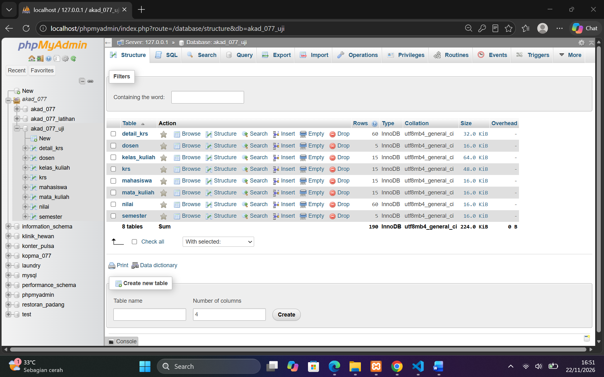

## Laporan Praktikum Basis Data - Pertemuan 8
**Nama** : Divva Ramadhan Puja Pratama

**NPM** : 25430077

**Kelas** : C

**Tanggal** : 22 November 2026

**Dosen Pengampu** : Dedi Irawan, S.Kom., M.Kom.

### 1. Tujuan Praktikum

Praktikum ini bertujuan untuk memastikan database yang telah dibuat dapat berjalan dengan baik, memahami kembali struktur dan hubungan antar tabel, serta melatih
penggunaan SQL untuk melakukan perubahan data, menjalankan query, dan mengatasi error yang terjadi.

### 2. Ringkasan Dasar Teori

Database digunakan untuk menyimpan data agar lebih teratur dan mudah dikelola. SQL digunakan untuk membuat tabel, menambah data, mengubah data, dan menampilkan data
sesuai kebutuhan.

Dalam database terdapat Primary Key, Foreign Key, dan constraint yang berfungsi menjaga data serta hubungan antar tabel. Database juga perlu diuji untuk memastikan 
data yang dimasukkan sesuai aturan dan tidak terjadi kesalahan.

### 3. Hasil Langkah Percobaan

Pada praktikum Modul 8, dilakukan pengujian ulang database Sistem Informasi Akademik yang telah dibuat pada modul sebelumnya. Pengujian dimulai dengan menjalankan file instalasi SQL pada database kosong untuk memastikan tabel dan data berhasil dibuat.

Setelah instalasi berhasil, dilakukan latihan menggunakan SQL pada database `akad_077_latihan`. Latihan yang dilakukan meliputi penambahan kolom, pembuatan constraint, perubahan query, menghitung jumlah data, memperbaiki input yang salah, serta mengubah aturan Foreign Key.

Dari seluruh percobaan tersebut, dilakukan pengecekan terhadap hasil query dan perubahan data untuk memastikan perintah yang dijalankan sudah sesuai dengan yang diharapkan.

### 4. Titik Analisis

Dari praktikum yang telah dilakukan, setiap perintah SQL memiliki fungsi dan aturan yang berbeda. Penambahan constraint dapat membatasi data yang masuk, sedangkan perubahan Foreign Key dapat memengaruhi data pada tabel lain.

Selain itu, kesalahan saat menjalankan SQL tidak selalu berarti database rusak, tetapi bisa terjadi karena data yang dimasukkan tidak sesuai aturan atau perintah yang digunakan kurang tepat. Oleh karena itu, setiap perubahan perlu diperiksa kembali agar hasilnya sesuai dengan yang diharapkan.

### 5. Latihan dan Modifikasi

Pada bagian latihan, dilakukan beberapa percobaan menggunakan SQL, mulai dari menambahkan kolom dan membuat constraint, mengubah query, hingga menguji kesalahan input data. Selain itu, dilakukan juga perubahan aturan Foreign Key dari RESTRICT menjadi CASCADE.

Dari latihan tersebut, saya mencoba memahami bagaimana setiap perintah bekerja, melihat hasilnya secara langsung, dan memperbaiki perintah yang mengalami error sampai berhasil.

### 6. Tugas/Milestone Proyek

Pada Modul 8, dilakukan pengecekan kembali terhadap proyek Sistem Informasi Akademik yang telah dikerjakan dari Modul 1 sampai Modul 7. Pengecekan meliputi struktur tabel, relasi antar tabel, data yang tersimpan, serta query yang telah dibuat.

File instalasi juga diuji pada database kosong untuk memastikan proyek dapat dijalankan kembali tanpa harus membuat tabel dan mengisi data secara manual.

### 7. Pembahasan dan Kendala

Selama latihan, terdapat beberapa error saat menjalankan SQL, seperti memasukkan data yang sama pada Primary Key, memasukkan nilai NULL pada kolom yang tidak diperbolehkan, dan mengubah aturan Foreign Key.

Error tersebut terjadi karena data atau perintah yang digunakan tidak sesuai dengan aturan database. Setelah diperiksa, kesalahan dapat diperbaiki dengan mengubah data atau menyesuaikan perintah SQL. Dari sini saya menjadi lebih memahami penyebab error dan cara mengatasinya.

### 8. Kesimpulan

Dari praktikum Modul 8, saya dapat memahami kembali cara kerja database dan penggunaan SQL untuk mengelola data. Saya juga belajar bahwa setiap tabel memiliki aturan yang harus diperhatikan dan perubahan pada database perlu dilakukan dengan benar.

Melalui latihan yang dilakukan, saya menjadi lebih memahami cara membaca error, mencari penyebabnya, dan memperbaiki perintah SQL yang salah. Praktikum ini juga membantu saya memahami kembali proyek Sistem Informasi Akademik yang telah dibuat dari modul sebelumnya.

### 9. Pernyataan Penggunaan AI

Selama mengerjakan praktikum ini, saya menggunakan AI untuk membantu memahami perintah SQL dan mencari penyebab error yang terjadi saat latihan. Dari penjelasan yang diberikan, saya mencoba kembali perintah tersebut di database dan melihat hasilnya secara langsung. Dengan begitu, saya bisa lebih memahami cara kerja SQL dan tidak hanya menggunakan perintah tanpa mengetahui fungsinya.

## 10. Bukti Git 
Tautan repository:https://github.com/DivvaRPP/basisdata.25430077

git commit : p08: milestone proyek 8

Hash commit: a31a907

## Checklist Laporan Pertemuan 8
| Jenis | Yang harus ada |
|---|---|
| ☑ Berkas wajib |p08_uts_<NIM>.md (ringkasan milestone 1–7) dan install_uts_<NIM>.sql|
| ☑ Bukti tangkapan layar |Bukti basis data berjalan dari skrip DDL dan data (instalasi bersih)|
| ☑ Analisis wajib |Catatan modifikasi langsung saat demo; refleksi keputusan desain yang akan diperbaiki |

